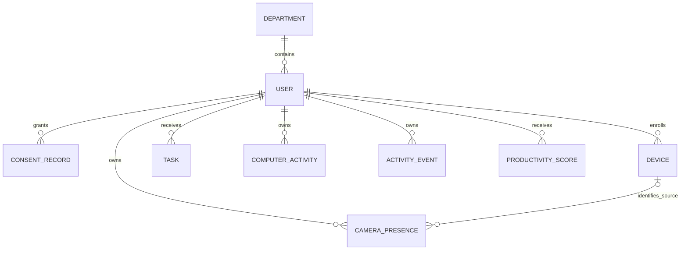

# WorkTrack

React frontend, Django API, computer activity agent болон camera monitor нь нэг
`backend/` сервер, нэг database ашиглана. Root болон `backend/` доторх `manage.py`
хоёулаа ижил Django төслийг ажиллуулна.

## Нэг даралтаар асаах (macOS)

Finder-ээс төслийн хавтас дахь **Start WorkTrack.command**-ийг нээнэ;
default нь вебээс удирдах desktop горим.
Энэ нь Python environment, backend dependency, npm dependency-ийг шаардлагатай үед
бэлдэж, migration хийгээд backend, frontend, онооны болон backup scheduler, локал
удирдлагыг асаана. Agent/camera нь хэрэглэгч товч дарахаас өмнө **асахгүй**.
Ижил төслийн одоогийн кодтой backend өмнө нь ажиллаж байвал дахин асаахгүй.
Browser автоматаар нээгдэнэ. Хуучин кодтой backend (`--noreload` орно) эсвэл өөр
төслийн сервер 8000 порт дээр байвал migration хийхээс өмнө алдаа мэдээлнэ.
Өмнөх backend/launcher цонхонд Ctrl+C дараад дахин нээнэ; өөр process-ийг
автоматаар зогсоохгүй.
Анх удаа Python 3 болон Node.js/npm суусан байх шаардлагатай; байхгүй бол `.command` юу дутууг
хэлээд татах хуудсыг нь browser-т нээнэ.
`backend/requirements.txt`, `package.json`, `package-lock.json` өөрчлөгдвөл launcher
dependency-ийг дахин суулгана; өөрчлөгдөөгүй үед давтаж суулгахгүй. npm шинэчлэх
шаардлагатай байхад хуучин frontend ажиллаж байвал түүний terminal-д Ctrl+C дараад
launcher-аа дахин нээнэ. Dependency fingerprint нь `.runtime/dependencies.json` дотор байна.

- Вебэд өөрийн account-аар нэвтрээд **Миний өнөөдөр** нүүрийг ашиглана.
- Төхөөрөмжийн нэр → мэдээлэл бүртгэх зөвшөөрөл → **Төхөөрөмж холбох** гэсэн
  гурван алхмыг хийнэ. Agent-д дахин password оруулахгүй; тусдаа JWT үүсгэж 0600
  permission-тэй локал файлд хадгална. Password файлд хадгалахгүй.
- **Ажил эхлүүлэх**, **Түр зогсоох**, **Ажил үргэлжлүүлэх**, **Ажил дуусгах** товчтой.
- Camera хэрэгтэй бол **Camera бэлтгэх**, дараа **Camera асаах** дарна. Ажил эхэлсэн,
  pause биш үед л camera асаана; OS permission тусдаа шаардагдаж болно.
- WorkTrack.app-ийн Dock → Quit эсвэл төхөөрөмжийн нэмэлт үйлдлийн **WorkTrack хаах**
  нь тухайн launcher өөрөө асаасан process-уудаа зогсооно. `.command` хувилбарт Ctrl+C
  мөн ажиллана. Өмнө нь тусад нь асаасан серверийг хаахгүй.

Дараагийн удаа аппыг нээж **Ажил эхлүүлэх** дарахад хангалттай. Agent-ийн login
дууссан бол нэмэлт үйлдлийн **Дахин холбох** ашиглана. Вебээс гарахад тусдаа agent
session үргэлжилдэг тул бүртгэл зогсоохдоо **Ажил дуусгах** дарна.

`.app` нь энэ төслийн хавтастай хамт ажиллах локал launcher; Python 3, Node.js болон
source-гүйгээр тараах standalone installer биш. Хавтсаас нь салгаж зөөхгүй; Dock-д
shortcut нэмэж болно. Generated `.app` Git-д орохгүй. `.command` desktop горимоор
анх асахад байхгүй бол автоматаар үүсгэнэ. Дахин бүтээх команд:

```bash
.venv/bin/python desktop/build_macos_app.py
```

Аппын wrapper нь Cocoa native startup/Quit ашиглана. Эх кодоос `.app` бүтээхэд
macOS Xcode Command Line Tools (`clang`) хэрэгтэй; бэлэн локал bundle-ийг өдөр тутам
нээхэд дахин compile хийхгүй. Build нь түр хавтаст compile/sign/verify хийгээд
төслийн хавтаст тавина.

**WorkTrack.app-ийн GUI startup/Quit одоогоор баталгаажаагүй**: compile болон ad-hoc
signature шалгалт амжилттай, харин энэ орчны disposable GUI туршилтад helper
хугацаандаа эхлээгүй. Одоохондоо `.command` хувилбарыг ашиглана. GUI шалгалтыг
Mac дээр `python verify_desktop_app.py` буюу `python verify_camera_ai.py --native`
командаар тусад нь ажиллуулна; `qa/bugs.json`-ийн QA-05 нээлттэй хэвээр.

Цоо шинэ суулгалтад admin байхгүй бол launcher browser-ийг **Анхны тохиргоо** хуудсаар нээнэ:
админы нэр, нууц үгээ оруулаад шууд нэвтэрнэ (terminal хэрэггүй). Энэ хуудас нь launcher-ийн
үүсгэсэн нэг удаагийн нууц холбоосоор (`#setup=…`) л ажиллаж, admin үүссэний дараа хаагдана.
Холбоос мөн launcher-ийн цонхонд хэвлэгдэнэ. Бэлтгэл дутууг `.runtime/app.log` дотор мэдээлнэ.

Terminal-аас ашиглах хувилбарууд:

```bash
python3 worktrack.py              # Backend + frontend + agent, camera сонголт
python3 worktrack.py --web-only   # Зөвхөн веб систем
python3 worktrack.py --camera     # Agent болон camera хамт
python3 worktrack.py --desktop    # Вебээс тохируулах/удирдах; camera эхэндээ унтраалттай
```

Log-ууд `.runtime/backend.log`, `frontend.log`, `scheduler.log`, `backup.log`, `agent.log`, `camera.log` дотор байна.
Launcher ажиллаж байхад agent-ийг өөр terminal эсвэл OS startup script-ээр давхар
асаахгүй. macOS startup helper-ийн тохиргоо launcher-аас тусдаа хэвээр.

## Нэг даралтаар асаах (Windows)

Windows 10/11 дээр macOS-той ижил ажиллана; `.command`-ийн оронд **Start WorkTrack.bat**.

1. Төслийн хавтас дахь **Start WorkTrack.bat**-ийг давхар товшино.
2. Python эсвэл Node.js байхгүй бол цонх асууна: **Y** дарвал Windows-ийн `winget`-ээр суулгана
   (Windows зөвшөөрөл асууж магадгүй). Дуусмагц цонхоо хаагаад `.bat`-аа дахин нээнэ. `winget`
   байхгүй бол [Python 3.12](https://www.python.org/downloads/) (суулгахдаа **Add python.exe to PATH**)
   болон [Node.js LTS](https://nodejs.org/)-ийн татах хуудсыг browser-т нээнэ.
3. Анх удаа `.venv`, dependency, migration-ийг бэлдэнэ (хэдэн минут). Default нь вебээс удирдах
   desktop горим; browser өөрөө нээгдэнэ. Admin байхгүй бол **Анхны тохиргоо** хуудас нээгдэж,
   админы нэр, нууц үгээ оруулаад шууд нэвтэрнэ.
4. Хаах: вебийн **WorkTrack хаах** эсвэл цонхонд **Ctrl+C**. Ингэхэд agent сүүлийн хугацаагаа
   хадгалж, backend/frontend бүгд зогсоно. Цонхыг **X**-ээр хаавал бүх process мөн зогсоно (сервер
   үлдэхгүй), гэхдээ agent сүүлийн 30 секунд хүртэлх хугацааг хадгалж амжихгүй байж болно.
5. Camera: **Settings → Privacy & security → Camera** дээр "Camera access" болон
   "Let desktop apps access your camera"-г асаана. Хаалттай бол вебэд энэ замыг зааж харуулна.

Анхаарах зүйл:

- Интернэтээс татсан zip-ээс нээхэд "Windows protected your PC" гарвал **More info → Run anyway**.
- Terminal-аас: `"Start WorkTrack.bat" --web-only` эсвэл `.venv\Scripts\python.exe worktrack.py --camera`.
- Log-ууд `.runtime\*.log` дотор. 8000/5173/8766 порт дээр өөр програм байвал асахгүй.
- `WorkTrack.app` болон `agent/install_macos_launch_agent.py` нь зөвхөн macOS-д; Windows-д `.bat` ашиглана.
- Windows дээр файлын `0600` эрх үйлчлэхгүй; token/config файлууд Windows-ийн хэрэглэгчийн
  хавтасны эрхээр хамгаалагдана. Төслөө өөрийн хэрэглэгчийн хавтас (жишээ нь `Documents`) дотор байлгана.
- `.github/workflows/windows.yml` нь push бүрт Windows дээр бүх тест, browser тест болон
  `verify_launcher.py --agent` (launcher асаах, agent эхлүүлэх/зогсоох, Ctrl+Break-аар хаах) ажиллуулна.

## Тохируулах

```bash
python3 -m venv .venv
source .venv/bin/activate
pip install -r backend/requirements.txt
npm ci
cp backend/.env.example backend/.env
```

`backend/.env` дахь `DJANGO_SECRET_KEY`-г өөрийн random утгаар солино.
Хэрэв файл өмнө нь байгаа бол хуулж дарж болохгүй.
Backend зөвхөн `backend/.env` дахь `DJANGO_*` болон баримтжуулсан бусад түлхүүрийг
уншина. Root `.env` нь шаардлагатай үед frontend-ийн `VITE_API_URL`-д зориулагдсан;
түүний `SECRET_KEY`, `DEBUG` нь Django-г тохируулахгүй. `.env` файлууд Git-д орохгүй.

```bash
python manage.py migrate
python manage.py createsuperuser
python manage.py runserver
```

Хоёр дахь terminal:

```bash
npm run dev
```

http://localhost:5173 дээр superuser-аар нэвтэрнэ. Vite `/api/` хүсэлтийг
http://127.0.0.1:8000 руу дамжуулна. Production build-д ижил origin reverse proxy
эсвэл build хийхээс өмнө `VITE_API_URL` болон backend CORS тохируулна.

## Хэрэглэх дараалал

Өдөр тутам **Миний өнөөдөр** нүүрнээс ажлаа эхлүүлнэ. Өөрийн илгээгдсэн хугацаа,
ашигласан апп, сүүлд бүртгэгдсэн апп, дуусаагүй task-уудыг 30 секунд тутам шинэчилнэ.
Энэ нүүр admin-д ч зөвхөн өөрийн мэдээллийг харуулна; багийн мэдээлэл Dashboard,
Даалгавар, Тайлан хэсэгт хэвээр. Төхөөрөмжийн локал төлөв 5 секунд тутам шинэчлэгдэнэ.
**Миний бүртгэл** хэсэгт одоогийн нууц үгээ оруулж шинээр сольж болно. Хуучин
access/refresh session-ууд хүчингүй болж, agent-аа дахин холбоно. Мартсан нууц үгийн
recovery биш; мартсан бол admin reset хийнэ. **Багийн гишүүд** хэсэгт нэвтрэх нэр
харагдана. Админ өөрөөсөө бусад идэвхтэй гишүүний **Нууц үг шинэчлэх** товчийг
дарж, шинэ нууц үгийг хоёр удаа оруулан хадгална. Шинэ нууц үгийг ажилтанд хувийн
сувгаар дамжуулна; хуучин access/refresh нэвтрэлтүүд хүчингүй болж, ажилтан дахин
нэвтрэн төхөөрөмжөө холбоно. Ажилласан хугацаа, даалгавар хэвээр үлдэнэ.
Нэвтрэх дэлгэцэд админтай холбогдох заавар бий; имэйлээр өөрөө сэргээх боломжгүй.
Нууц үгийн JWT хамгаалалт нэмэгдсэн тул
энэ шинэчлэлээс өмнөх login-оор нэг удаа дахин нэвтрэх шаардлагатай.

Локал удирдлага зөвхөн `127.0.0.1:8766` дээр ажиллаж, frontend-ийн `/desktop/`
proxy-оор холбогдоно. Хүсэлт бүрийн JWT-г backend-аар баталгаажуулж, Host/Origin
болон тусгай header шалгана. Өөр account ажиллаж буй agent/camera-г удирдах буюу
login-ийг нь дарж холбохгүй. Зөвхөн урьдчилан тогтоосон үйлдэл, launcher өөрөө
асаасан process-уудыг удирдана; shell command дамжуулах endpoint байхгүй.
Public deployment нь энэ desktop bridge-ийг интернетэд гаргахгүй. Локал удирдлага
ашиглахдаа энэ Mac-ийн WorkTrack.app-аар нээгдсэн локал вебийг хэрэглэнэ.

1. Багийн гишүүд хэсэгт username, нэр, нууц үгтэй employee үүсгэнэ.
   Хэлтсээ вебийн «Багийн гишүүд» хэсэгт үүсгэж сонгоно. Manager-д хэлтэс заавал байна.
2. Даалгавар хэсэгт идэвхтэй ажилтанд task хуваарилж, deadline, status оруулна.
   Чанарын үнэлгээг 0–100, хоёр орны нарийвчлалтай оруулаад «Үнэлгээ хадгалах» дарна.
3. Ажилтан өөрийн account-аар agent-д нэвтэрч, monitoring consent олгоно.
4. Agent/camera өгөгдөл ирсний дараа Dashboard дээр ажилтан, өдөр сонгож
   «Оноо тооцох / шинэчлэх» дарна. Application, camera, score нь database-аас уншигдана.

Admin бүх хэрэглэгчийг, manager өөрийн хэлтсийг, employee зөвхөн өөрийн өгөгдлийг харна.
Task-ийн үндсэн мэдээлэл, төлөв, чанарын үнэлгээг admin/manager засна.
Ажилтан өөрт хуваарилагдсан даалгаврын цаг, хувийг бүртгэж, шилжүүлэх хүсэлт гаргана.
Нэр, task зэрэг бизнес өгөгдөл browser-ийн
localStorage-д хадгалагдахгүй. Login session нь tab-ийн sessionStorage-д хадгалагдана.

## Програмын цаг, даалгаврын оролцоо ба шилжүүлэг

- **WorkTrack асаалттай байсан сарын нийт хугацаа** нь account-тай холбосон
  локал launcher нээлттэй байсан хугацааг сар бүр нийлүүлнэ. Веб refresh хийх,
  програмыг хааж дахин нээхэд тэглэхгүй. **Сар сонгох**-оор өмнөх сарыг харна.
  Улаанбаатарын цагаар сар солигдох заагт хугацааг хоёр сард хуваана.
- **Миний өнөөдөр** нүүрэнд **WorkTrack асаалттай байсан сарын нийт хугацаа** болон
  **Өнөөдөр бүртгэгдсэн хугацаа** зэрэгцэн харагдана. Хоёр дахь нь зөвхөн өнөөдрийн
  серверт хадгалагдсан computer activity-ийн нийлбэр бөгөөд idle хугацааг багтаана;
  бүх өдрийн нийт дүн биш. Програмын цаг секунд тутам, хадгалсан бүртгэл 30 секунд
  тутам шинэчлэгдэнэ.
- Сарын локал түүх `.runtime/launcher-usage.sqlite3` файлд 5 секунд тутам
  хадгалагдана (Git-д орохгүй). Энэ файлыг устгавал төхөөрөмж дээрх түүх болон
  серверт хараахан илгээгээгүй цаг алдагдана. Хаалттай үеийг тоолохгүй; 15 секундээс
  урт хэмжилтийн завсар, Sleep/цагийн зөрүүг алгасана. Гэнэт унтарвал сүүлийн
  checkpoint-оос хойших хэдэн секунд хадгалагдахгүй байж болно. Энэ нь ажигласан
  хугацааны ойролцоо хэмжилт; цалингийн баталгаат бүртгэл биш.
- Төхөөрөмжийг өөр account-тай холбох үед хуучин цагийг шинэ хүнд шилжүүлэхгүй.
  Шинэ хувилбараас өмнөх хэмжигдээгүй хугацааг зохиож нөхөхгүй. Нэвтрэлт,
  төхөөрөмж, monitoring зөвшөөрлийг серверээр шалгасны дараа л тооцож эхэлнэ.
  Түр зогсоосон agent-тай үед програм нээлттэй цаг үргэлжилнэ; **Төхөөрөмж салгах**
  эсвэл WorkTrack-ийг хаахад зогсоно. Camera асаах шаардлагагүй.
- Desktop launcher 30 секунд тутам өөрийн төхөөрөмжийн хугацааг серверт
  автоматаар илгээнэ. Баталгаажсан account-ийн сүлжээ түр тасрахад локалд хадгалж,
  сэргэсэн үед давхардуулахгүй нөхөн илгээнэ. Зөвшөөрөл цуцлагдсан/төхөөрөмж
  disabled болсон бол шинэ тоолол зогсоно. Өөр account эсвэл өөр төхөөрөмжийн
  хүлээгдэж буй бүртгэлийг тухайн төхөөрөмжийн нэрээр илгээхгүй.

### Админы сарын тайлан

Admin/manager нэвтрэхэд **Миний өнөөдөр** нүүрэнд сарын тайлан шууд гарна.
**Тайлан** цэсэнд мөн байна; 30 секунд тутам шинэчлэгдэнэ. Тусдаа command эсвэл
сарын эцсийн ажиллагаа шаардлагагүй. Admin бүх хэрэглэгчийг, manager өөрийн
хэлтсийг, employee зөвхөн өөрийгөө харна. Email илгээх тохиргоо шаардахгүй.

- WorkTrack нээлттэй байсан цаг: нэг ажилтны давхардсан төхөөрөмжийн интервалыг
  нэг удаа тоолно. Локал карт зөвхөн тухайн төхөөрөмжийн цаг, админы тайлан серверт
  ирсэн бүх төхөөрөмжийн нийлсэн хугацааг харуулдаг тул sync хүртэл зөрж болно.
- Апп ашигласан болон Idle цаг: хадгалагдсан ComputerActivity-ийн сарын нийлбэр.
- Даалгаврын цаг: ажилтан **Ажиллаж эхлэх** дарж бүртгэсэн session-уудын зөвхөн
  сонгосон сард хамаарах хэсэг. Нээлттэй session-д 90 секундийн lease үйлчилнэ.
- Тухайн сард дууссан, одоо хариуцаж буй даалгаврын тоо/нэр; зөвшөөрсөн
  шилжүүлгийн өгсөн/авсан тоо. Дэлгэрэнгүйд даалгаврын сарын цаг болон
  нийт даалгаварт оруулсан **одоогийн** хувь гарна (сарын эцсийн хувь гэж үзэхгүй).
- Програм нээлттэй цаг, аппын цаг, даалгаврын цагийг хооронд нь нэмэхгүй;
  аль нь ч дангаараа бүтээмжтэй ажилласан гэдгийг батлахгүй.

Хугацаа хэтэрсэн raw computer activity-г цэвэрлэхдээ сарын аппын нийлбэрийг
тусдаа хүснэгтэд хадгална. Offline replay давхар нэмэхээс хамгаалсан checksum
үлдэнэ; raw segment дахин үүсэхгүй. Өмнөх хувилбараар аль хэдийн устгасан
өгөгдлийг сэргээхгүй. Database backup сарын тайланг багтаана; launcher-ийн локал
SQLite ledger-ийг тусад нь нөөцлөх шаардлагатай.

### Даалгаврын хамтын оролцоо

- **Даалгавар → Ажиллаж эхлэх** дарж тухайн ажилд цагаа бүртгэнэ. Дээд талын
  **Даалгаврын цаг зогсоох** товч бүх хуудсанд байна. Нэг ажилтан зэрэг нэг л
  даалгаварт цаг бүртгэнэ. Энэ нь хэрэглэгчийн эхлүүлсэн таймер; аппын ерөнхий
  хэрэглээг даалгаварт автоматаар оноохгүй, бүтээмжийн нотолгоо гэж үзэхгүй.
- Веб нээлттэй үед 20 секунд тутам холболтоо батална. Browser хаах, компьютер
  унтах, сүлжээ тасрахад сүүлчийн холбооноос **хамгийн ихдээ 90 секунд** нэмж
  тоолоод зогсоно. Эргэн холбогдоод **Ажиллаж эхлэх** дарна. Refresh болон хуудас
  солиход ажиллаж буй таймер серверээс сэргэнэ. Вебээс гарах үед таймераа зогсооно.
- **Миний хийсэн хувь** нь нийт даалгаврын хэдэн хувийг өөрөө хийснийг тэмдэглэх
  утга. Жишээ: эхний хүн 35%, дараагийн хүн 40%, сүүлийн хүн 25% = нийт 100%.
  Нийлбэр 100%-аас хэтрэхгүй. Гишүүн бүрийн цаг, цагийн эзлэх хувь, өөрийн
  оруулсан гүйцэтгэлийн хувь тусдаа харагдана. Өмнөх ажлуудад цаг/хувь зохиож нөхөхгүй.
- Одоогийн хариуцагч эсвэл эрх бүхий admin/manager **Шилжүүлэх хүсэлт** илгээнэ.
  Ажилтан/manager өөрийн хэлтсийн идэвхтэй гишүүнийг, admin бүх хэлтсээс сонгоно.
  Хүлээн авагч мэдэгдэл эсвэл даалгаврын жагсаалтаас **Хүлээн авах / Татгалзах**
  сонгоно. Хүлээн авах хүртэл хариуцагч хэвээр, зөвшөөрмөгц өмнөх хүний таймер
  зогсож, цаг/хувь нь түүхэнд үлдэнэ. Шинэ хүн таймераа өөрөө эхлүүлнэ.
- Нэг даалгаварт зэрэг нэг хүсэлт байна. Зөвшөөрсөн шилжүүлгийг нийт **хоёр удаа**
  хийнэ; татгалзсан, цуцалсан хүсэлт тоонд орохгүй. Дууссан ажил шилжихгүй.
  Хариуцагчийг шууд PATCH эсвэл Django admin-аар солихгүй; зөвшөөрлийн урсгал хэрэглэнэ.
  Өмнө оролцсон ажилтан тухайн ажлын түүхийг уншиж болно; одоогийн хариуцагч л
  өөрийн цаг/хувийг засна. Энэ мэдээлэл нь одоогийн өдрийн онооны томьёонд нэмэгдэхгүй.

Шинэ хүснэгтүүдийг launcher-ийн `migrate` алхам автоматаар үүсгэнэ. Гараар асаах
бол `.venv/bin/python manage.py migrate` ажиллуулж backend-ээ дахин асаана.

## Agent төлөв, тайлан, өөрчлөлтийн түүх

- **Agent төлөв**: account, төхөөрөмж, computer/camera-ийн online, pause, offline
  төлөв, сүүлийн холболт/илгээлт, хүлээгдэж буй queue, алдааны төрлийг харуулна.
  Үндсэн agent болон camera 30 секунд тутам heartbeat илгээнэ; 90 секундээс
  хуучирвал offline болно. Огт heartbeat ирээгүй төхөөрөмжийг ажиллаж байна гэж
  таамаглахгүй. Хуудсыг 30 секунд тутам шинэчилнэ. Өөр хувилбарын
  `activity_agent/` collector өөрийн heartbeat илгээдэггүй; үндсэн launcher ашиглана.
- **Тайлан → Тайлан татах**: эхлэх/дуусах өдөр, ажилтан, CSV эсвэл Excel (.xlsx)
  сонгоно. Admin бүх, manager хэлтсийн, employee өөрийн өгөгдлийг экспортолно.
  Нэг хүсэлтэд хамгийн ихдээ 366 өдөр, 50,000 мөр. Хадгалсан score байхгүй бол
  нүдийг хоосон үлдээнэ; автоматаар оноо зохиохгүй. Computer/work секунд болон
  presence sample тоо тусдаа баганатай; presence-ийг ажилласан хугацаа гэж үзэхгүй.
  Spreadsheet formula болж ажиллаж болох хэрэглэгчийн нэрийг text болгон хамгаална.
- **Өөрчлөлтийн түүх**: task, чанарын үнэлгээ, хэрэглэгчийн эрх/идэвх, consent,
  monitoring тохиргоо, тайлан экспортын actor/time болон зөвшөөрсөн талбаруудыг
  хадгална. API болон Django admin-ийн task/user өөрчлөлтүүд ижил түүхэнд орно.
  Нууц үг, password hash, token хадгалахгүй; history API нь зөвхөн унших эрхтэй.
- **Мэдэгдэл**: хугацаа хэтэрсэн/өнөөдөр дуусах task, offline agent, upload алдаа,
  queue хүлээгдэж байгааг веб дотор харуулна. Асуудал шийдэгдмэгц дараагийн
  шинэчлэлтээр арилна. Email болон гаднын чат руу илгээхгүй.
- **Тохиргоо** (зөвхөн admin): ажилд тооцох апп, camera confidence threshold,
  local CSV-ийн хэмжээ/backup/хоног, database activity хадгалах хоногийг удирдана.
  Agent дараагийн амжилттай холболтоор өөрчлөлтийг авна; сүлжээ тасарвал ажиллаж буй
  process сүүлийн авсан тохиргоогоо хэрэглэнэ. Нэгэн зэрэг зассан хуучин хувилбарыг
  409 хариугаар буцааж, дахин уншихыг шаардана. Local CSV-д өөрчлөлт хэрэгжихэд
  шинэ хязгаарт багтах хуучин generated log-ууд цэвэрлэгдэж болно.

Автомат database цэвэрлэгээ эхэндээ **унтраалттай**. Admin үүнийг тусад нь сонгож
хадгалсан үед launcher-ийн backup scheduler амжилттай backup авсны дараа л
хуучин activity-г устгана. Доорх backup/retention хэсгийг үзнэ үү.

## Computer agent (үндсэн)

```bash
pip install -r activity_agent/requirements.txt
cp agent/config.example.json agent/config.json
python agent/main.py --login
python agent/main.py --grant-consent 2026-11
python agent/main.py
```

Тохиргооны API URL нь `http://127.0.0.1:8000`. Employee account-аар login хийнэ.
Agent нь device enroll, JWT refresh, offline queue ашиглана. OS-specific setup-ийг
`agent/` доторх script-үүдээс харна. Давхар хугацаа бүртгэхээс сэргийлж нэг компьютер
дээр хоёр computer agent зэрэг ажиллуулахгүй.

### Үндсэн agent-ийн хугацааны нарийвчлал

`agent/config.json` дахь `poll_interval_seconds` нь идэвхтэй апп шалгах давтамж
(default **1 секунд**), `interval_seconds` нь сервер рүү хуримтлагдсан segment-үүдийг
илгээх давтамж (default **30 секунд**) юм. Хуучин config-д шинэ түлхүүр байхгүй байсан
ч 1 секундийн default автоматаар хэрэглэгдэнэ.

VS Code → Safari → VS Code гэж 30 секунд дотор солигдсон ч segment бүр тусдаа
хадгалагдана. Апп хэвээр байсан ч 30 секунд тутам segment-ийг тасалж илгээнэ.
Upload нь тусдаа thread дээр ажилладаг тул сүлжээ удаашрахад sampler-ийг хүлээлгэхгүй.
Segment хаагдах бүрд offline queue-д хадгална; retry нь дараагийн upload мөчлөгт хийгдэнэ.
Ctrl+C үед сүүлийн ажигласан цаг хүртэлх segment-ийг хадгалж, queue илгээхэд
хамгийн ихдээ 5 секунд хүлээнэ. Үлдсэн өгөгдөл дараагийн асаалтанд дахин илгээгдэнэ.

Энэ нь polling тул 1 секундээс богино апп шилжилт алдагдаж болно; OS lookup удах үед
бодит sample хоорондын хугацаа уртсаж болно. Апп таних алдаа гарвал танигдаагүй
завсрыг өмнөх аппад таамгаар нэмэхгүй. Pause үед шинэ хугацаа цуглуулахгүй.
Энэ өөрчлөлт alternative `activity_agent/`-ийн collector-т хамаарахгүй.

### Өдөр солигдох, sleep/resume

Үндсэн agent-ийн interval-ийг `Asia/Ulaanbaatar`-ын 00:00 заагаар хуваана.
Жишээ нь 23:59:50–00:00:10 хооронд Code ашиглавал хоёр өдөрт тус бүр 10 секунд
хадгална. OS timezone өөр байсан ч тайлангийн өдөр Улаанбаатараар тооцогдоно.
API-ийн 3600 секундийн хязгаарыг давах урт segment мөн жижиглэгдэнэ.

`max_sample_gap_seconds` нь default **10 секунд**. Хоёр observation хооронд
үүнээс урт завсар гарвал үндсэн agent өмнөх segment-ийг сүүлийн баталгаатай
observation дээр дуусгаж, сэрсний дараа шинээр эхлүүлнэ. Sleep болон удаан гацсан
завсрыг ашигласан хугацаанд тооцохгүй. Энэ нь OS sleep event биш, sampling gap-д
суурилсан хамгаалалт учраас 10 секундээс богино sleep-ийг ялгахгүй.

Wall clock болон monotonic clock зөрөх, цаг ухрах үед мөн interval тасална.
Цаг ухарвал өмнө хадгалсан дууссан цагт хүрэх хүртэл шинэ хугацаа бүртгэхгүй,
ингэснээр давхардсан мөр үүсгэхгүй. Компьютерийн цаг серверээс ихээр түрүүлсэн бол
серверийн future-time validation хүсэлтийг буцааж болох тул OS цагийг зөв тохируулна.

Single-person camera uploader ч segment-ээ өдөр болон 3600 секундээр хуваана.
Camera timestamp нь дууссан цаг тул яг 00:00-д дууссан хэсэг өмнөх өдөрт тоологдоно.
Backend camera тайланд өмнө нь хадгалсан өдөр дамнасан мөрийн хугацааг мөн хоёр
өдөрт хувааж харуулна; database-ийн хуучин мөрийг өөрчлөхгүй. Camera tracker мөн `max_camera_gap_seconds` (default 10) хамгаалалттай. Single болон
multi-person горимд урт observation gap-ийг тооцохгүй, өмнөх хугацааг сүүлийн frame
ажигласан timestamp-тайгаар хадгална.

## Activity agent (өөр хувилбар)

```bash
pip install -r activity_agent/requirements.txt
python agent/main.py --login
python agent/main.py --grant-consent 2026-11
```

`activity_agent/config.json` дахь `employee_id`-г login хийсэн username болгон солино.
`token_file` нь үндсэн agent-ийн JWT файл; `dev-token` ашиглахгүй.

```bash
python activity_agent/agent.py run
```

`POST /api/v1/activity` compatibility endpoint нь batch-ийг ижил Django database-д
хадгалж, retry хийхэд ижил мөрийг дахин үүсгэхгүй. Aggregate app хугацаанд дарааллын
мэдээлэл байдаггүй тул хадгалсан цагийн offset нь бодит foreground дараалал биш.
Энэ contract-ийн аппуудыг төв monitoring тохиргооны productive apps жагсаалтаар
`WORK`, browser нэрээр `BROWSER`, харилцааны аппын нэрээр `COMMUNICATION`, бусдыг
`OTHER` гэж ангилна. Idle хугацааг `Idle/OTHER`, апп нь тодорхойгүй active хугацааг
`Unattributed activity/OTHER` segment болгон хадгалж, W-ийн нийт хугацаанд оруулна.
Keyboard/mouse event тоонуудыг database-д хадгалахгүй. Mock server нь зөвхөн тусдаа
тестийн хэрэгсэл; үндсэн системд асаах шаардлагагүй.

## Camera

macOS дээр `NSCameraUsageDescription` дутуу Python process-оос capture хийхэд TCC
процессыг SIGABRT-аар хааж болно. Camera CLI болон вебийн товч нь өөрийн signed
**WorkTrack Camera** bundle дотор Python/OpenCV-г ажиллуулна. System Python-ийн
Info.plist-ийг өөрчлөхгүй. Camera болон төслийн хавтсын тайлбар bundle-д байна;
камерын OS зөвшөөрлийг capture-ээс өмнө шалгана. Зөвшөөрөөгүй бол crash хийхийн
оронд Settings → Privacy & Security → Camera → WorkTrack Camera гэдгийг заана.

Bundle нь эхний ашиглалтад Command Line Tools-оор build хийгдэж, macOS-ийн private
temporary cache-д хадгалагдана. Ингэснээр iCloud Desktop-ийн Finder metadata кодын
signature-д саад болохгүй. Cache арилсан, Python эсвэл host эх код өөрчлөгдвөл
дахин бүтээнэ. Зураг/видео хадгалахгүй; зөвхөн одоогийн presence metadata хэвээр.
Startup-ийг цуцлахад session permit эхэлж хүчингүй болно. Хоцорч ассан native host
болон OS permission хүлээж буй worker цуцлагдсан session-оор capture эхлүүлэхгүй.

```bash
pip install -r requirements.txt
python main.py
```

`config.yaml`-ийн `api_sync.enabled: true` нь camera state-ийг agent-ийн account,
device, token ашиглан илгээнэ. Default `camera_mode: presence` үед зөвхөн timestamp,
`present` boolean, confidence хадгалж `/api/camera-presence/ingest/` ашиглана.
Camera permission болон тухайн session-д зөвшөөрөл шаардлагатай. API нь active
monitoring consent-ийг үргэлж шалгана. Presence нь productivity score-д шууд орохгүй.
Өмнөх state experiment-ийг `python main.py --mode activity` гэж тусад нь асаана;
тэр нь `/api/activity-events/ingest/` ашиглана. Multi-person identity integration
хийгдээгүй. Аль ч горимд raw зураг API руу илгээхгүй.

API sync асаалттай үед presence, legacy activity болон multi-person бүх горим server consent lease,
local pause-ийг шалгаж, татгалзсан/хугацаа дууссан үед camera-г суллаж, CSV бичихээ
зогсооно. `--seconds 20` хугацааны хязгаар бүх горимд үйлчилнэ. Multi-person-ийн
server identity/sync байхгүй тул зөвхөн consent-оор хамгаалсан local log үүсгэнэ.
Legacy CSV ч хэмжээ/хоногоор эргэлдэнэ. Presence, single-person, multi-person-ийн
CSV бүтэц өөр тул `config.yaml` дахь `log_file`-ийг тусдаа нэрээр сонгоно;
өөр бүтэцтэй хуучин файл дээр мөр нэмж хольж бичихгүй.

## Camera, AI, QA, documentation

Энэ хэсэг нь 5 дахь гишүүний 7 өдрийн ажлын хэрэгжүүлэлт, хэмжилт болон demo-ийн
лавлагаа. Ажлын manifest: [qa/board.json](qa/board.json), consent checklist:
[qa/consent_checklist.csv](qa/consent_checklist.csv), bug/validation gap:
[qa/bugs.json](qa/bugs.json). Нэг README-г үндсэн баримт хэвээр ашиглана.

| Өдөр | Бэлэн үр дүн | Баталгаажуулалт |
|---|---|---|
| 1 | Privacy scope, task manifest, GitHub issue/PR template | `.github/ISSUE_TEMPLATE/qa-task.yml`, `.github/pull_request_template.md` |
| 2 | ERD/API review, 5 fictional test user-ийн consent lifecycle | `backend/activity/test_presence.py` |
| 3 | Agent expected/actual event report: switch, stable, pause, sleep, idle | `qa/fixtures/agent_cases.json`, `qa/agent_correctness.py` |
| 4 | OpenCV/YOLO person present/absent, configurable confidence, metadata log | `src/presence.py`, `src/detector.py`, `tests/test_presence.py` |
| 5 | Random Forest Low/Medium/High experiment, feature/label contract, grouped holdout | `ai/experiment.py`, `qa/fixtures/ai_demo.csv` |
| 6 | Camera Precision/Recall/F1, AI Accuracy/F1, final QA runner, CI artifacts | `evaluate_camera.py`, `verify_camera_ai.py`, `.github/workflows/qa.yml` |
| 7 | Demo script, test evidence, rehearsal checklist | `qa/evidence/final-qa.json`, `qa/rehearsal.json`; хүнтэй rehearsal pending |

### Privacy ба test data

Default camera mode нь frame-ийг RAM-д боловсруулна. YOLO-д `save=False`,
`save_txt=False`, `save_crop=False`, `show=False` өгдөг; OpenCV зөвхөн preview
харуулна. Frame/video, нүүрний embedding, bounding box, нэр, нас болон хүн таних
мэдээлэл хадгалахгүй. `confidence` нь threshold-ийг давсан person detection-уудын
хамгийн их confidence; person илрээгүй бол 0. Энэ нь хүн байхгүй гэсэн probability
эсвэл ажиллаж байгаа гэсэн үнэлгээ биш. Default threshold 0.45; model/threshold-ийг
хэмжилтийн тайланд хамт тэмдэглэж, test set дээр тааруулж өндөр metric гаргахгүй.

Local CSV: `data/presence.csv`, баганууд `timestamp,present,confidence`.
`presence_log_max_bytes` default 5 MiB; хэмжээ хүрэхэд эсвэл Улаанбаатарын өдөр
солигдоход шинэ CSV нээнэ. `presence_log_backups: 3` нь хамгийн ихдээ 3 дугаарласан
backup, `presence_log_retention_days: 7` нь хуучин generated CSV-г цэвэрлэнэ.
Хуучин файл аль хэдийн хязгаараас том байвал хамгийн сүүлийн бүтэн мөрүүдийг
үлдээж atomic rewrite хийнэ. Өөр нэртэй manual archive-д хүрэхгүй.
Offline queue: `data/.pending_presence_events.json`; upload нь тусдаа thread,
bounded queue, retry/quarantine болон shared token lock ашиглана. API дээр employee
нь JWT-ээс, device нь тухайн хэрэглэгчийн enroll-оос тогтоно. Зураг/video зэрэг
илүү field, бусдын device, ирээдүйн timestamp, NaN/Infinity confidence-ийг хүлээн
авахгүй. Ижил timestamp-тай ижил sample replay 200; өөр утгатай replay 400.

Session camera consent-ийг `python main.py` асууна. Launcher-ийн camera `y` сонголт
нь тухайн camera session-ийн зөвшөөрөл болно. `python agent/main.py --pause` эсвэл
`--revoke-consent` нь local camera sampling-ийг pause хийнэ. API sync асаалттай үед
camera нээхээс өмнө server consent-ийг background шалгалтаар баталгаажуулна.
Шалгалт 1 секунд тутам; баталгаа 3 секундээс хуучирвал эсвэл шалгалт алдахад
camera pause болж, preview харлаж, local CSV-д шинэ sample бичихгүй. Серверийн
401/403 upload denial мөн зөвшөөрлийг шууд invalidate хийнэ. Inference дундуур
зөвшөөрөл өөрчлөгдвөл тухайн sample-ийг хаяж, дараагийн loop дээр camera-г суллана.
Pause болон consent хүлээх үед ч `q` ажиллана. Consent дахин баталгаажиж, local
pause тайлагдвал collection үргэлжилнэ. API sync унтраасан standalone demo нь
тухайн session-ийн explicit local consent ашиглана.
Зөвшөөрлийг бодит хүний өмнөөс автоматаар олгохгүй. 5 checklist account нь зөвхөн
Django-ийн түр test database-д үүснэ; бодит database-д user/consent нэмэхгүй.
Real label цуглуулахын өмнө оролцогч сайн дураар зөвшөөрч, хүрээг тайлбарлуулсан байна.

Presence metadata нь `cleanup_activity --days 90` preview болон `--apply` retention-д
хамрагдана. Local presence CSV дээр дээрх rotation/retention үйлчилнэ; manually
цуглуулсан label файлуудыг хэрэгцээ дуусмагц оператор устгана. Эдгээрийг Git-д
оруулахгүй. QA artifact-д scalar aggregate, fictional fixture л оруулна.

### ERD / API review



Review: user ownership FK; device устгавал presence device нь NULL, user устгавал
өөрийн presence cascade; `(employee,timestamp)` unique. API list нь admin бүх,
manager өөрийн хэлтэс, employee зөвхөн өөрийн metadata-г харна. Presence list нь
read-only, ingest нь зөвхөн өөрийн JWT identity-д бичнэ. Confidence нь [0,1],
present нь JSON boolean. Backend migration: `0004_camerapresence`.

```json
{"timestamp":"2026-11-06T10:00:00+08:00","present":true,"confidence":0.83}
```

Үүнийг JWT header-тэй `POST /api/camera-presence/ingest/` рүү илгээнэ. Five-user
тест нь no-consent 403 → grant → 201 → replay 200 → self-only list → revoke → 403
дарааллыг тус бүрд шалгана. Foreign device/ownership, invalid metadata, manager
scope болон бодит HTTP upload + JWT refresh мөн тесттэй.

### Random Forest experiment

Dashboard API нь сонгосон ажилтан/Улаанбаатарын өдрийн `presence` summary-г буцаана:
нийт, present/absent sample count, present хувь, сүүлийн timestamp/boolean/confidence.
Frontend-ийн Camera activity хэсэг эдгээрийг харуулна. Sample count-ийг ажилласан
минут гэж хөрвүүлэхгүй; official score-д presence boolean-ийг шууд ашиглахгүй.

```bash
pip install -r requirements-ai.txt
python -m ai.experiment
python -m ai.experiment --csv qa/fixtures/ai_demo.csv --data-kind synthetic
```

Бүх feature нь нэг тогтсон research window-ийн [0,1] aggregate ratio:

| Feature | Тодорхойлолт |
|---|---|
| `active_ratio` | non-idle секунд / ажиглагдсан computer секунд |
| `work_app_ratio` | тохируулсан WORK app секунд / ажиглагдсан computer секунд |
| `presence_ratio` | present sample / ажиглагдсан camera sample |
| `task_completion_ratio` | тухайн window-д оноосон task-аас дууссан хувь |

Zero observation/zero assigned task үед 0 гэж таахгүй: бодит dataset-д missing
window-ийг хасаж эсвэл тусдаа missing-data protocol тодорхойлно. Feature бүр ижил
window-д хамаарах ёстой; window дууссаны дараах task outcome-ийг input-д оруулахгүй.
Жинхэнэ label нь тусдаа human annotation rubric-аар Low/Medium/High байна;
ажилтны чанарыг camera-аар дүгнэхгүй. Real annotator-ууд feature/таамаглалыг харж
label хуулж тавихгүй; санал зөрөлдөх, missing label-ийг тусад нь бүртгэнэ.

Одоогийн 450 window, 5 fictional participant-ийн dataset **synthetic**. Label нь
noisy latent simulation-оос үүссэн; бодит бүтээмжийн ground truth биш. CSV нь
`participant_id,sample_id,data_kind,active_ratio,work_app_ratio,presence_ratio,task_completion_ratio,label`
гэсэн яг энэ schema-тай. Seed 42, 200 tree, max depth 6, min leaf 3.
Participant-аар `GroupShuffleSplit`: train 3 participant / 270 sample, test 2 / 180;
оролцогчийн давхцал 0. Test set-ийг hyperparameter сонгоход ашиглаагүй.
Одоогийн нэг split нь тогтвортой generalization/шалтгаант үр нөлөөг батлахгүй.
Report-д library version, seed, dataset checksum, baseline, class support,
confusion matrix, feature importance орно. Official scoring formula-д model-ийг
холбоогүй. Data хангалтгүй тул энэ нь **experimental result** хэвээр.

### Camera evaluation ба metric table

Бодит label цуглуулахдаа оролцогчийн зөвшөөрөлтэйгээр:

```bash
python -m qa.collect_camera_labels --consent
python evaluate_camera.py .runtime/qa/camera-labeled.csv --mode presence --data-kind real --output .runtime/qa/camera-metrics.json
```

Operator `p` (person present), `a` (absent) expected label-ийг **inference-ээс өмнө**
өгнө; prediction-оос expected label үүсгэхгүй. Утга хадгалахдаа timestamp, random
sample ID, expected/predicted boolean, confidence, data kind л хадгална. Янз бүрийн
гэрэл, зай, хагас халхлалт, present/absent-ийн coverage хэрэгтэй. Зорилтот validation
нь тус бүр дор хаяж 50 бие даасан present/absent observation, нэг frame-ийг олон
удаа тоолж metric өсгөхгүй. 100 sample нь хүртэл production certification биш.

| Хэмжилт | Өгөгдөл / хамрах хүрээ | Одоогийн үр дүн |
|---|---|---|
| Camera live smoke | Зөвшөөрсөн 20 metadata sample; human label байхгүй | 19 present, 1 absent prediction; accuracy тооцоогүй |
| Camera evaluator fixture | 8 **synthetic** мөр | Precision 0.750, Recall 0.750, F1 0.750; бодит camera metric биш |
| Camera real Precision/Recall/F1 | Independent human labels | **Pending** |
| Random Forest Accuracy | Synthetic; 180 held-out sample | 0.7611 |
| Random Forest macro F1 | Synthetic; Low/Medium/High | 0.7624 |
| Majority baseline Accuracy | Ижил synthetic holdout | 0.3333 |

Precision = TP/(TP+FP), Recall = TP/(TP+FN), F1 = 2TP/(2TP+FP+FN).
Denominator байхгүй metric нь null; support/coverage болон confusion matrix-ийг
хамт харна. Synthetic fixture-ийг real гэж дамжуулбал evaluator алдаа өгнө.
Хуучин 4-state evaluation `python evaluate_camera.py states.csv` хэвээр ажиллана.

### Final QA ба PR evidence

```bash
python verify_camera_ai.py
```

Python camera/AI tests → computer agent → alternative agent → Django integration
(5 consent test user орно) → frontend unit/lint/build → mocked browser tests →
түр database-тай бодит Django/browser demo-г ажиллуулна. Жинхэнэ webcam-ийг автоматаар
асаахгүй, бодит database-д fake user/record нэмэхгүй. Тест бүрийн command, exit code,
хугацаа, log, Git revision, dirty flag, source checksum, agent expected/actual events,
AI болон synthetic evaluator metric-ийг `.runtime/qa/final-qa.json`-д бичнэ.
Алдаа/тасалдсан run-ийг passed гэж бичихгүй. Full QA-д Chromium хэрэгтэй:
`npx playwright install chromium`. `--skip-browser` нь бодит browser/Django run-ийг
explicit skipped болгон тэмдэглэнэ; full-system QA-тай адил гэж үзэхгүй.

Сүүлийн reviewed snapshot: [qa/evidence/final-qa.json](qa/evidence/final-qa.json).
Real hardware smoke log-ийн aggregate-ийг report-д нэмэх бол
`--camera-log .runtime/qa/camera-live.csv` ашиглана; raw frame хэрэггүй.
CI workflow нь PR/main run бүрийн evidence/log-ийг 14 хоногийн artifact болгоно.
Remote CI run нь push хийгдсэний дараа л үүснэ; local test-ийг remote CI гэж нэрлэхгүй.

GitHub issue board: [7 өдрийн board #9](https://github.com/tugsbilegb49-coder/team-project1/issues/9),
[milestone](https://github.com/tugsbilegb49-coder/team-project1/milestone/1), task issue #2–#8.
Нэвтрэх эрхийг нэмэгдүүлэхгүйгээр одоогийн git login-оор issue/milestone board үүсгэсэн.
Дахин sync хийх болон тусдаа GitHub Projects хувилбар:

```bash
python qa/publish_board.py              # Reviewable dry-run; GitHub холболт шаардахгүй
python qa/publish_board.py --apply --issues-only  # Одоогийн git login; issue/milestone board
python qa/publish_board.py --apply      # Тусдаа GitHub Projects; gh auth + project эрхтэй үед
python qa/publish_board.py --apply --project 3   # Өмнөх project-оо дахин ашиглана
```

Publisher нь manifest-ийн 7 issue-г үүсгэж project-д холбоно; acceptance checkbox-ийг
шалгаагүй байхад Done гэж хаахгүй. Дахин ажиллуулахдаа өмнөх project number-ийг
өгнө. Existing issue-г title-аар дахин ашиглана. Багийн **PR бүрд** linked issue,
tested revision, command/result, CI artifact URL шаардлагатай. PR template-ийн
evidence-г linked issue/project item дээр мөн шинэчилнэ. GitHub холболтгүй үед
manifest нь local бэлтгэл; remote board үүссэн гэж үзэхгүй.

### 7 дахь өдрийн demo / rehearsal

1. `Start WorkTrack.command` нээж, admin login, test ажилтан/task болон dashboard
   урсгалыг харуулна. Бодит хүний нэр/нууц мэдээлэл demo-д оруулахгүй.
2. Privacy scope-ийг тайлбарлаж, сайн дурын demo account-ийн monitoring consent,
   camera session permission-ийг өгнө.
3. `python main.py --consent --seconds 20` — хүн харагдах, frame-ээс гарах, буцаж
   орохыг харуулна. `data/presence.csv`-ийн зөвхөн 3 багана, зураг/video байхгүйг шалгана.
4. Pause/resume, consent revoke хийж sampling болон API rejection-ийг харуулна.
   Camera-г Ctrl+C/q-ээр бүрэн зогсооно.
5. `python -m ai.experiment` ажиллуулж Low/Medium/High, Accuracy/F1, baseline,
   grouped holdout, synthetic хязгаарлалтыг тайлбарлана.
6. `python verify_camera_ai.py` болон report-ийг харуулж agent expected/actual,
   consent lifecycle, browser/API integration болон open validation gap-уудыг хэлнэ.
7. Launcher-ийг Ctrl+C-ээр зогсоож camera indicator унтарсныг шалгана.

Жинхэнэ rehearsal хийсэн хүн [qa/rehearsal.json](qa/rehearsal.json)-д presenter,
performed_at, алхам бүрийн actual result/evidence-г бичнэ. Автомат тест нь хүний
live presentation rehearsal-ийг хийсэн гэж батлахгүй.

Implementation лавлагаа: [Ultralytics predict](https://docs.ultralytics.com/modes/predict/),
[RandomForestClassifier](https://scikit-learn.org/stable/modules/generated/sklearn.ensemble.RandomForestClassifier.html),
[GroupShuffleSplit](https://scikit-learn.org/stable/modules/generated/sklearn.model_selection.GroupShuffleSplit.html).

## Database ба хуучин backend

SQLite default файл: `backend/db.sqlite3`. PostgreSQL-д `backend/.env` дахь
`POSTGRES_*` утгуудыг тохируулаад migrate хийнэ. Хуучин root `db.sqlite3`-ийг өөрчлөхгүй;
түүний `core` schema-г шинэ database руу автоматаар зөөхгүй. `legacy/core/` нь өмнөх
хэрэгжүүлэлтийн эх код бөгөөд үндсэн серверт ачаалагдахгүй. Доорх API заавар нь
зөвхөн одоогийн `backend/` серверт хамаарна. Хуучин `core/` endpoint болон model-ууд
одоогийн API-тай ижил биш; өмнөх эх код, зааврыг Git түүхээс харж болно.

Оноо нь `backend/scoring/services.py`-ийн дүрмийг ашиглана: T/Q/D нь task-аас,
W нь computer activity-ийн WORK харьцаанаас; computer data байхгүй үед camera
WORKING харьцаанаас гарна. Энэ дүрэм хуучин `core`-ийн дүрмээс ялгаатай.

## Онооны тодорхой дүрэм

| Үзүүлэлт | Тооцоолол |
| --- | --- |
| T | Тухайн өдөр due болсон task-уудаас тэр өдрийн эцэс гэхэд DONE болсон хувь |
| Q | Дээрх completed task бүрийн `quality_score`-ийн дундаж |
| D | Тухайн өдөр due болсон нийт task-аас deadline өдрөөсөө оройтохгүй дууссан хувь |
| W | WORK секунд / нийт computer activity секунд × 100; idle, browser, unknown хугацаа нийтэд орно |
| P | `0.4T + 0.3Q + 0.2D + 0.1W` |

Computer data байхгүй бол W нь camera-ийн WORKING / нийт camera секунд болно.
Camera fallback байгаа нь аппын W-тэй ижил хэмжигдэхүүн биш бөгөөд онооны энэ
хувилбарын сонгосон дүрэм юм. T/Q/D-д task байхгүй бол 0, activity байхгүй бол W=0.
Өгөгдөлгүй өдрийн 0 нь баталгаатай муу гүйцэтгэл гэсэн дүгнэлт биш.
P-г 0–100-д хязгаарлаж 2 оронд тоймлоно. LOW: P < 65, MEDIUM: 65 ≤ P < 85,
HIGH: P ≥ 85. Энэ нь дүрэмд суурилсан тооцоо; AI таамаглал биш.

Дууссан task-ийн completion timestamp эсвэл Q үнэлгээ дутуу бол шинэ оноо
хадгалахгүй. API 400 болон асуудалтай `task_ids` буцаана. 0 гэсэн чанарын үнэлгээ
бол зөв утга; null-аас ялгаатай. Хэрэв өмнөх score байсан бол түүнийг өөрчлөхгүй;
өмнөх `calculated_at`-тай тооцоо хэвээр үлдэнэ. Үнэлгээг нөхөөд дахин тооцно.
Дараагийн өдөр дууссан task нь өмнөх өдрийн T/Q/D-г буцааж нэмэгдүүлэхгүй.
Өдрийн CLI/scheduler нь үнэлгээ дутуу ажилтныг log-д мэдээлээд бусдын тооцоог үргэлжлүүлнэ.

Alternative agent-ийн server allowlist-ийг `backend/.env`-д тохируулна:

```dotenv
PRODUCTIVE_APPLICATIONS=Visual Studio Code,Code,PyCharm,WINWORD,Microsoft Word
```

App нэрийн том/жижиг үсэг, `.exe`, `.app` өргөтгөлийг normalize хийнэ. `code.exe`
нь `Code`-той таарна. Safari/Chrome нь default WORK биш. Ажлын browser-ийг WORK
болгох шаардлагатай бол нэрийг жагсаалтад ил тод нэмнэ. Серверээ дахин асааж хэрэглэнэ.
Энэ жагсаалт alternative batch-д үйлчилнэ; үндсэн agent-ийн ангиллыг
`agent/config.json` дахь `productive_apps` удирдана.

Өмнө хадгалсан ангиллыг автоматаар өөрчлөхгүй. Accepted batch-ийг replay хийхэд
allowlist өөрчлөгдсөн байсан ч өмнөх category хадгалагдана. Хуучин `OTHER` мөрүүдийг
дахин ангилах migration энэ өөрчлөлтөд ороогүй. Шинэ дүрмээр оноогоо харахын тулд
өгөгдөл/чанарын үнэлгээгээ шалгаад score-оо дахин тооцно.

## Оноо автоматаар шинэчлэх

`Start WorkTrack.command` launcher нь backend/frontend-тэй хамт score scheduler
асаана. `--web-only` горимд ч scheduler ажиллана. Асаах үед болон дараа нь
**60 секунд тутам**, `Asia/Ulaanbaatar` timezone-оор **өнөөдөр ба өчигдрийн**
идэвхтэй хэрэглэгчдийн оноог дахин тооцно. Ингэснээр agent-ийн шинэ activity,
шөнө дунд дамнасан бүртгэл, хоцорч ирсэн queue, нөхөж оруулсан quality үнэлгээ
дараагийн мөчлөгт тусна. Ижил employee/date score-ийг шинэчилнэ, давхар score үүсгэхгүй.

Чанарын үнэлгээ дутуу ажилтныг log-д мэдээлээд алгасна; бусдыг үргэлжлүүлнэ.
Дараагийн мөчлөгт дахин шалгана. Database түр завгүй эсвэл бэлэн биш үед алдааг
log-д бичээд дараагийн мөчлөгт дахин оролдоно. Log: `.runtime/scheduler.log`.
Launcher-ийг Ctrl+C-ээр зогсооход өөрийн асаасан scheduler мөн зогсоно.

Гараар серверүүдээ асаадаг бол scheduler-ийг тусдаа terminal-д ажиллуулна:

```bash
python manage.py run_score_scheduler                 # Default: 60 секунд
python manage.py run_score_scheduler --interval 120  # 120 секунд тутам
python manage.py run_score_scheduler --once          # Хоёр өдрийг нэг удаа тооцоод гарах
```

Docker Compose-ийн scheduler мөн `--interval 60` ашиглана. Хуучин `--hour` болон
`--minute` сонголтыг шинэчилж `--interval` болгосон. Давтамж 10–3600 секунд байна.

Хоёроос олон хоногийн өмнөх өгөгдөл өөрчлөгдвөл тухайн өдрийг тусад нь дахин тооцно:

```bash
python manage.py calculate_daily_scores --date 2026-11-01
```

Компьютер унтарсан эсвэл launcher зогссон үед локал scheduler ажиллахгүй. Дахин
асаахад зөвхөн өнөөдөр/өчигдрийг нөхөж тооцно; бүх хуучин өдрийг автоматаар нөхөхгүй.
Вебийн нээлттэй хуудас автоматаар дахин хүсэлт явуулдаг болоогүй: шинэ оноог харахдаа
Dashboard-ийн «Шинэчлэх» дарна. «Оноо тооцох / шинэчлэх» товч гараар шууд тооцох
боломж хэвээр байна.

## Backup, restore болон хадгалалтын хязгаар

### Database backup

```bash
python manage.py backup_database
python manage.py backup_database --output backend/backups/my-backup.sqlite3
```

Default файл нь `backend/backups/database-TIMESTAMP-RANDOM.sqlite3` (SQLite)
эсвэл `.dump` (PostgreSQL). Existing output файлыг дарж бичихгүй. Backup файл
0600 permission-тэй бөгөөд `backups/`, `*.dump`, `*.sqlite3` нь Git-д орохгүй.
Database дотор account/password hash, token blacklist, task болон activity байдаг тул
backup-ийг хувийн, найдвартай хадгалалт руу өөрөө хуулна. Энэ команд backup-ийг
автоматаар cloud руу upload хийхгүй. Launcher одоо өдөр тутмын backup scheduler
хамт асаана; доорх автомат backup хэсгийг үзнэ үү.

SQLite нь online backup API ашиглаж WAL дахь committed өгөгдлийг хамруулна.
PostgreSQL нь custom-format `pg_dump`, restore-д `pg_restore` ашиглана. Эдгээр CLI
суусан, server-тэй нийцэх хувилбартай байх ёстой. Нууц үгийг command argument-д
бичихгүй; subprocess environment-оор дамжуулна. 2026-11-06-нд PostgreSQL 17.11-ийн тусдаа түр cluster дээр бодит backup/restore,
safety backup-ийг өөр database-д сэргээх туршилт амжилттай хийгдсэн.

### Restore

Эхлээд файлыг өөрчлөлтгүй шалгана:

```bash
python manage.py restore_database backend/backups/my-backup.sqlite3
```

Жинхэнэ restore хийхийн **өмнө launcher, тусдаа backend/scheduler, agent/camera-аа
зогсооно**. Ижил project/schema-гийн backup ашиглана. Дараа нь:

```bash
python manage.py restore_database backend/backups/my-backup.sqlite3 --apply --confirm-stopped
```

`--confirm-stopped` нь process-уудыг автоматаар унтраахгүй; өөрөө зогсоосныг
баталж өгч буй flag. Restore-оос өмнө одоогийн database-ийн safety backup-ийг
`backend/backups/` дотор үүсгэнэ. SQLite integrity/schema шалгалт хийж, live database
файлыг өөрт нь restore хийхийг хориглоно. PostgreSQL restore нь single transaction
ашиглана. Restore амжилттай бол launcher-аа дахин асаана; сэргээгдсэн account,
password, token төлөв backup авсан үеийнх болно. Локал agent queue нь тусдаа файл
тул database restore түүнийг буцааж сэргээхгүй.

### Хуучин activity цэвэрлэх

```bash
python manage.py cleanup_activity --days 90          # Зөвхөн тоо, cutoff харуулна
python manage.py cleanup_activity --days 90 --apply --backup  # Backup шалгаад устгана
```

Default хадгалалт төв тохиргооноос (анх 90 хоног), minimum 1 хоног. Camera-ийн дууссан timestamp,
computer interval-ийн дууссан цагаар cutoff-оос бүхэлдээ өмнөх мөрийг сонгоно.
Cutoff дамнасан segment-ийг хадгална. User, task, consent, device болон хадгалсан
score-уудыг устгахгүй. `--apply` байхгүй үед юу ч устгахгүй. Автомат горим зөвхөн
admin-ийн opt-in тохиргоогоор асна. Устгалын сонголтод тухайн үеийн ID хязгаар
ашиглаж, backup хүлээх зуур шинээр ирсэн хуучин timestamp-тай мөрийг хамруулахгүй.
`--backup` нь устгахаас яг өмнө шинэ backup үүсгэж шалгана; алдаа гарвал устгахгүй.
Автомат горим үргэлж энэ хамгаалалттай. `retention-*.sqlite3/.dump` generated safety
backup-аас хамгийн сүүлийн 7-г хадгална; daily/manual backup-д хүрэхгүй.
SQLite файл logical delete хийсний дараа шууд жижигрэх албагүй.

Цэвэрлэсэн хуучин өдрийн score-ийг дараа нь дахин тооцвол activity өгөгдөл нь
байхгүй тул W өөрчлөгдөж болно. Хуучин тайлангаа дахин тооцох шаардлагатай бол
retention хугацаагаа уртасгах эсвэл backup-аас тусдаа орчинд шалгана.

### Offline queue хязгаар

Үндсэн agent: `agent/config.json` дахь `max_queue_events` (default 10000),
`max_queue_bytes` (default 10485760 буюу 10 MiB). Camera-д ижил утгууд
`config.yaml`-ийн `api_sync` дотор байна. Alternative agent-ийн config нь
`max_spool_batches=10000`, `max_spool_bytes=10485760` ашиглана.

Queue дүүрвэл **хамгийн шинэ бүртгэлүүдийг хадгалж, хуучин бүртгэлүүдийг хасна**;
ганц мөр нь byte хязгаараас том бол тэр мөрийг алгасна. Хасагдсан тоог log-д
мэдээлнэ. Хязгаараас хэтэрсэн offline хугацааны бүх өгөгдөл хадгалагдана гэсэн
баталгаа байхгүй. Хязгаарыг нэмэх эсвэл backend холболтоо сэргээх шаардлагатай.
Queue нь UTF-8 файлд бичигдэх бодит хэмжээгээр хязгаарлагдана; temp файл бичих
зуур дискэнд нэмэлт зай хэрэгтэй. Agent upload хийж байх үед queue дүүрсэн ч
хараахан илгээгдээгүй шинэ мөрийг андуурч устгахгүй.

Үндсэн agent болон camera uploader-ийн event endpoint 400/409/413/422 буцаавал
тухайн мөрийг queue-тай ижил хавтасны `*.rejected.json` файлд тусгаарлаж,
дараагийн мөрийг илгээнэ. Тусгаарласан файл хамгийн сүүлийн 1000 мөр, 1 MiB
хязгаартай; timestamp, HTTP status, event хадгална. Түүнийг шалгаж өгөгдлийн
шалтгааныг засна. Auth/refresh алдаа, 404, 408, 429, 5xx болон сүлжээний алдаанд
queue-г хадгалж дараа дахин оролдоно. Тусгаарласан файлыг бичиж чадахгүй бол
эх мөрийг queue-д үлдээнэ.

Camera segment-ийг эхлээд дискэнд хадгалж, HTTP upload-ийг тусдаа thread хийнэ.
Backend удаашрахад frame loop сүлжээ хүлээхгүй. Зогсоохдоо upload-д 5 секунд
хүлээж, үлдсэнийг дараагийн асаалтад илгээнэ. Python integration-д
`uploader.flush(timeout=5)`-аар хүлээж, `uploader.close()`-оор worker-ийг хаана.

Үндсэн agent, camera, alternative agent нь JWT файлыг process хоорондын lock,
давтагдахгүй temp файл, atomic replace ашиглан бичнэ. Refresh-ийн хариу хожуу
ирэхэд шинэ login-ийг дарах эсвэл logout хийсэн login-ийг сэргээхгүй.

Queue/spool нь API origin болон JWT user ID-аас гаргасан hash нэрээр account бүрт
тусдаа хадгалагдана. Ижил account дахин нэвтрэх/refresh хийхэд өмнөх queue үргэлжилнэ;
өөр account-ийн мөрийг авахгүй. Ажиллаж буй collector-ийн login солигдвол зогсоож,
тухайн account-ийн queue-г хадгална. Account солихдоо agent/camera-аа эхлээд зогсоож,
шинээр login хийгээд дахин асаана. Хуучин account тодорхойгүй bare queue болон
`unverified` файл автоматаар одоогийн хэрэглэгчид оноогдохгүй. Файлыг хадгалж,
эзэмшигчийг тусад нь шалгана; зүгээр нэрийг нь солиод upload хийж болохгүй.

## Үлдсэн ажлуудын нэмэлт хэрэгслүүд

### Хуучин backend-ийн архив

Өмнөх `core/` source нь `legacy/core/` дотор бүрэн хадгалагдсан. Үндсэн Django
`INSTALLED_APPS`-д орохгүй, хуучин root database-ийг нүүлгээгүй. Өдөр тутмын өөрчлөлтөө
`backend/` дээр хийнэ. `pytest.ini` нь root pytest-ийг `tests/` дээр ажиллуулж,
архивын Django tests-ийг санамсаргүй импортлохоос хамгаална. Backend tests-ийг
`python manage.py test users workforce activity scoring` гэж тусад нь ажиллуулна.

### Хуучин activity шалгах, ангиллыг засах

```bash
python manage.py review_activity --limit 100           # Preview, database өөрчлөхгүй
python manage.py review_activity --employee 2          # Нэг ажилтан
python manage.py backup_database
python manage.py review_activity --apply               # Зөвхөн aggregate category засна
```

Invalid duration, ирээдүйн болон давхардсан interval-ийг ID-тай нь мэдээлнэ.
Зөвхөн `activity_agent` platform, `activity-agent-` device prefix-тэй aggregate
record-ийн category-г server allowlist-аар засна. `Idle`, unknown хугацаа болон
үндсэн agent-ийн ангиллыг өөрчлөхгүй. Буруу timestamp/duration-ийг тааж засахгүй,
ямар ч мөр устгахгүй. Тэдгээрийг эх сурвалжтай тулгаж гараар шалгана. Ангилал
зассан хуучин өдрүүдийн score-ийг тусад нь дахин тооцно.

### Өдөр тутмын автомат backup

Launcher нь score scheduler-ээс тусдаа `run_backup_scheduler` процесс асаадаг.
Асаах үед болон цаг тутам шалгаж, Улаанбаатарын нэг өдөрт нэг `daily-*.sqlite3`
эсвэл `daily-*.dump` үүсгэнэ. Default-аар **сүүлийн 7 daily backup** үлдээнэ.
Гараар авсан `database-*`, restore-ийн safety backup, custom нэртэй файлуудыг
retention устгахгүй. Backup байхгүй/эвдэрсэн эсвэл copy диск олдохгүй үед log-д
алдаа мэдээлээд дараагийн цагт retry хийнэ; copy амжилтгүй бол local retention хийхгүй.

```bash
python manage.py run_backup_scheduler --once
python manage.py backup_cycle --keep 14
python manage.py backup_cycle --copy-dir /Volumes/MyBackup/WorkTrack --keep 7
```

Copy directory урьдчилж үүссэн, диск mount болсон байх ёстой. Хоёр дахь хуулбарыг
SHA-256 checksum-аар шалгадаг. `BACKUP_KEEP`, `BACKUP_COPY_DIR` environment-оор
scheduler-ийг тохируулна. Docker-д энэ disk path-ийг backup container дотор volume
болгон тусад нь mount хийх шаардлагатай. External хуулбаруудыг автоматаар prune
хийхгүй. Log: `.runtime/backup.log`. Launcher унтарсан үед автомат backup ажиллахгүй.

### Олон төхөөрөмжийн урт HTTP soak ба camera үнэлгээ

```bash
python verify_soak.py --seconds 60 --devices 3
python verify_soak.py --seconds 28800 --devices 10     # 8 цагийн synthetic HTTP soak
```

Үргэлжлэх хугацааг хурдасгахгүй: 28800 нь бодит 8 цаг ажиллана. Түр SQLite test
DB, бодит Django HTTP сервер дээр synthetic device-ууд сегмент илгээж, replay,
JWT refresh, saved login дахин ашиглах, нийт record count-ийг шалгана. Үндсэн
user/database, camera болон foreground app capture ашиглахгүй. Report нь
`.runtime/soak-report.json`. Process тасарвал report-ийг амжилттай гэж бичихгүй.

60 секунд / 3 device туршилт: 180 segment, дундаж HTTP ~8 ms, max ~50 ms,
давхар record үүсээгүй. Энэ нь 8 цагийн бодит төхөөрөмжийн баталгаа биш;
8 цагийн run болон олон бодит workstation-ийн тестийг хараахан ажиллуулаагүй.

Camera-ийн accuracy-д хүний баталгаажуулсан label хэрэгтэй. CSV-ийн жишээ:

```csv
expected,predicted
WORKING,WORKING
PHONE,IDLE
```

```bash
python evaluate_camera.py /path/to/manually-labeled.csv
```

Accuracy, state бүрийн precision/recall, confusion matrix гаргана. Label байхгүй
state-ийн metric нь null; бодит annotation байхгүй үед accuracy-г зохиож мэдээлэхгүй.
Нэг frame inference болон fake-clock gap тест нь accuracy судалгаа биш.

### Локал deployment бэлтгэл

`compose.production.yml` нь **backend API**-д зориулсан template; React build
оруулдаггүй. PostgreSQL 17, multi-worker Gunicorn, Caddy HTTPS proxy, score болон
backup scheduler агуулна. Backend/database host port нээхгүй; proxy л 80/443 нээнэ.
Database cache нь worker-уудын login throttle state-ийг хуваалцана; entrypoint
`createcachetable` ажиллуулдаг. `/api/health/` нь DB/cache round-trip шалгаж 200/503
буцаана. Process crash үед restart policy үйлчилнэ; unhealthy төлөв нь өөрөө
container restart хийх баталгаа биш. JSON logs нь 10 MiB × 3 файлаар эргэнэ.

```bash
cp deploy/production.env.example deploy/production.env
# Domain, private secret, password, CORS origin-оо өөрийн утгаар засна.
docker compose --env-file deploy/production.env -f compose.production.yml config
docker compose --env-file deploy/production.env -f compose.production.yml up -d --build
docker compose --env-file deploy/production.env -f compose.production.yml logs --tail=100 backend scheduler backup proxy
```

Бодит HTTPS-д domain DNS сервер рүү заасан, 80/443 хүрдэг байх шаардлагатай.
`DJANGO_DEBUG=false` үед placeholder/богино SECRET_KEY-г сервер хүлээн авахгүй.
`TRUST_PROXY_HEADERS` зөвхөн backend шууд интернетэд нээлтгүй үед хэрэглэнэ.
Trusted proxy IP нь template-ийн `172.30.0.2`; subnet өөрчилбөл IP ба trusted setting-ээ
хамт өөрчилнө. Caddy хэрэглэгчийн forwarded IP header-ийг overwrite хийдэг.
`CORS_ALLOWED_ORIGINS`-д зөвхөн зөвшөөрсөн frontend origin-уудыг бичнэ.
Production env болон backup-ууд image/Git-д орохгүй.

Энэ Mac дээр YAML/config, health/proxy tests, бодит 2-worker Gunicorn болон
PostgreSQL shared cache-ийг шалгасан. Docker/Caddy container build, бодит domain-ийн
TLS certificate, public deployment, external monitoring/alert-ийг ажиллуулаагүй.
Энэ хэсэг хэрэглэгчийн сонгосон **локал бэлтгэл**, public deployment биш.

Тохиргооны лавлагаа: [Django database cache](https://docs.djangoproject.com/en/5.2/topics/cache/#database-caching),
[Caddy reverse proxy](https://caddyserver.com/docs/caddyfile/directives/reverse_proxy).

## Шалгах

```bash
python manage.py check
python manage.py makemigrations --check --dry-run
python manage.py test users workforce activity scoring
python -m unittest discover -s agent -p 'test*.py'
python -m unittest discover -s activity_agent/tests
npm run test
npm run lint
npm run build
```

Launcher-ийг бодитоор асааж/зогсоох шалгалт (`python verify_launcher.py`) нь түр database
ашиглана. Холбогдсон төхөөрөмжтэй хавтсанд ажиллахгүй тул цэвэр checkout эсвэл CI-д ажиллуулна.

Integration тест нь JWT login → task → device/consent → computer/camera ingest →
score → dashboard урсгал, batch replay, бусдын account-аар бичихийг хориглох,
invalid batch-ийн atomicity-г шалгана. Бодит camera capture болон PostgreSQL-г
эдгээр SQLite тестүүд баталгаажуулахгүй.

## API лавлагаа

Business API бүр JWT authentication шаарддаг. Login-оос авсан access token-ийг
`Authorization: Bearer ACCESS_TOKEN` header-т явуулна. Access token 30 минут,
refresh token 1 өдөр хүчинтэй. Agent-ууд refresh token ашиглан access-аа шинэчилнэ.

| Endpoint | Method | Зориулалт |
| --- | --- | --- |
| `/api/auth/login/` | POST | Username, password-аар access/refresh авах |
| `/api/auth/refresh/` | POST | Refresh token-оор access шинэчлэх |
| `/api/me/today/` | GET | Зөвхөн өөрийн өнөөдрийн хугацаа, апп, task |
| `/api/me/password/` | POST | current_password/new_password/confirm_password; session-уудыг цуцална |
| `/api/desktop/link/` | POST | Өөрийн device + explicit consent; тусдаа agent JWT; no-store |
| `/api/auth/logout/` | POST | Өөрийн refresh token-ийг хүчингүй болгох; access authentication шаардлагатай |
| `/api/users/`, `/api/users/{id}/` | GET, POST / GET, PUT, PATCH, DELETE | User удирдах; өөрчлөх эрх зөвхөн admin |
| `/api/users/me/` | GET | Одоогийн хэрэглэгч |
| `/api/departments/`, `/api/departments/{id}/` | GET, POST / GET, PUT, PATCH, DELETE | Хэлтэс; өөрчлөх эрх зөвхөн admin |
| `/api/tasks/`, `/api/tasks/{id}/` | GET, POST / GET, PUT, PATCH, DELETE | Task; өөрчлөх эрх admin/manager |
| `/api/tasks/{id}/transfer-recipients/` | GET | Шилжүүлж болох гишүүдийн id, нэр; хэлтсийн эрхээр хязгаарлана |
| `/api/tasks/{id}/transfer-request/` | POST | `recipient`, `note`; нэг хүлээгдэж буй хүсэлт, нийт хоёр зөвшөөрсөн шилжүүлэг |
| `/api/tasks/{id}/transfer-respond/` | POST | `request_id`, `decision`: accept/decline/cancel; accept/decline зөвхөн хүлээн авагч |
| `/api/tasks/{id}/progress/` | POST | `percent`, `expected_percent`; одоогийн хариуцагчийн хувь, нийт ≤100 |
| `/api/tasks/{id}/work-start/` | POST | Хоосон JSON; нэг ажилтан нэг идэвхтэй таймер |
| `/api/tasks/{id}/work-stop/` | POST | `session_id`; зөвхөн өөрийн таймерыг зогсооно |
| `/api/tasks/work-session/` | GET, POST | Өөрийн session; POST `session_id` холболтыг батална, 90 секундийн хязгаартай |
| `/api/devices/enroll/` | POST | Өөрийн workstation бүртгүүлэх |
| `/api/devices/` | GET | Харах эрхтэй device-ууд |
| `/api/agent-status/` | GET | Эрхийн хүрээний төхөөрөмж, agent heartbeat/queue төлөв |
| `/api/agent-status/heartbeat/` | POST | Өөрийн enabled device-ийн operational metadata |
| `/api/monitoring-settings/` | GET, PATCH | Бүгд уншина; зөвхөн admin `expected_version`-той засна |
| `/api/notifications/` | GET | Task, agent, upload-ийн веб мэдэгдэл |
| `/api/audit/` | GET | Эрхийн хүрээний өөрчлөлтийн түүх; pagination |
| `/api/reports/export/?start=2026-11-01&end=2026-11-05&employee_id=all&file_type=xlsx` | GET | CSV эсвэл Excel өдрийн тайлан татах |
| `/api/reports/monthly/?month=2026-11` | GET | Эрхийн хүрээн дэх ажилтны сарын програм/апп/idle/даалгаврын цаг, дууссан ажил, шилжүүлэг |
| `/api/launcher-usage/` | POST | Өөрийн enabled device + active consent; `device_id`, ≤100 `intervals` (`event_id`, `started_at`, `ended_at`), давхардсан retry аюулгүй |
| `/api/consents/grant/` | POST | Өөрийн monitoring consent олгох |
| `/api/consents/revoke/` | POST | Өөрийн consent цуцлах |
| `/api/consents/status/` | GET | Өөрийн consent төлөв |
| `/api/computer-activity/ingest/` | POST | Үндсэн agent-ийн application segment |
| `/api/computer-activity/` | GET | Computer activity түүх |
| `/api/activity-events/ingest/` | POST | Өөрийн camera state segment |
| `/api/camera-presence/ingest/` | POST | Зөвшөөрөлтэй өөрийн presence boolean/confidence |
| `/api/camera-presence/` | GET | Эрхийн хүрээн дэх presence metadata; pagination ашиглана |
| `/api/activity-events/` | GET | Camera activity түүх |
| `/api/v1/activity` | POST | Өөр agent-ийн v1.0 batch; төгсгөлийн `/` байхгүй |
| `/api/scores/calculate/` | POST | Employee/date оноо тооцох буюу шинэчлэх |
| `/api/scores/dashboard/?employee_id=2&date=2026-11-05` | GET | Өдрийн score, application, camera summary |
| `/api/scores/` | GET | Харах эрхтэй онооны түүх |

List хариу нь `count`, `next`, `previous`, `results` бүтэцтэй; нэг хуудсанд 50 мөр.
`employee`, `employee_id`, `device_id` утгуудыг бодит API хариунаас авна.

Login хүсэлтийн JSON:

```json
{"username":"employee1","password":"YOUR_PASSWORD"}
```

Task үүсгэх JSON (admin/manager):

```json
{"employee":2,"title":"API integration","description":"Agent холбох","due_date":"2026-11-05","status":"TODO"}
```

Task status нь `TODO`, `IN_PROGRESS`, `DONE`. `DONE` болоход сервер `completed_at`
онооно; дахин нээхэд цэвэрлэнэ. `quality_score` нь 0–100 эсвэл null.

Computer segment-ийн JSON (тухайн employee-ийн token):

```json
{"started_at":"2026-11-05T10:00:00+08:00","duration_seconds":30,"application":"Code","category":"WORK"}
```

Category: `WORK`, `COMMUNICATION`, `BROWSER`, `OTHER`. Camera segment:

```json
{"timestamp":"2026-11-05T10:00:00+08:00","duration_seconds":30,"state":"WORKING"}
```

Camera state: `WORKING`, `PHONE`, `IDLE`, `AWAY`. Хоёр ingest endpoint-д enrollment
хариуны `device_id`-г нэмэх боломжтой; device нь нэвтэрсэн хэрэглэгчийнх байна.
`REQUIRE_MONITORING_CONSENT=true` үед өмнө нь consent grant хийсэн байх ёстой:

```json
{"policy_version":"2026-11"}
```

Оноо тооцох JSON:

```json
{"employee_id":2,"date":"2026-11-05"}
```

Admin бүх ажилтанд, manager өөрийн хэлтэст, employee өөртөө оноо тооцож болно.
Ирээдүйн өдрийн оноо тооцохгүй. Өгөгдөл өөрчлөгдвөл дахин тооцно.

## Frontend-ийн regression шалгалт

```bash
npm run test                         # API/session unit tests
npm run lint
npm run build
npx playwright install chromium      # Browser test runtime, нэг удаа
npm run test:e2e                      # Mock API-тай бодит browser regression
python verify_frontend.py            # Шинэ түр DB + бодит Django + browser smoke
```

Browser regression нь хадгалалтын үеийн task draft, manager-ийн хэлтэс,
идэвхгүй assignee, quality validation/save, report selection болон late response,
server logout, offline startup/retry, expired session, 320px chart overflow-ийг
шалгана. Playwright нь тусдаа Vite порт ашиглаж, үндсэн backend руу test өгөгдөл
бичихгүй. `verify_frontend.py` нь түр SQLite DB/server үүсгэж login → department →
manager → task → quality → deactivate → logout/refresh revocation урсгалыг
бодитоор ажиллуулаад бүх түр process/file-аа цэвэрлэнэ.

Default browser suite-д live smoke case алгасагдана; түүнийг `verify_frontend.py`-аар
ажиллуулна. Test artifact нь `.runtime/frontend-e2e/` дотор, Git-д орохгүй.
Өөр ажилтан/өдөр сонгоход хуучин тайлан шууд нуугдаж, шинэ хүсэлтийн хариуг л харуулна.
Хадгалалтын үед task form нуухгүй, талбаруудыг disable хийж draft-ийг хадгална.

## Бодит орчны шалгалт

2026-11-06-нд энэ Mac дээр хийсэн шалгалтууд:

| Шалгалт | Үр дүн |
| --- | --- |
| macOS foreground app | Safari → Code гэж бодитоор шилжүүлэхэд хоёул зөв танигдсан |
| Idle timer | OS-оос idle секунд уншигдсан |
| Camera capture | Webcam нээгдэж 1920×1080 frame ирсэн |
| Camera → YOLO → state | Бодит нэг frame боловсруулж хүчинтэй state буцаасан; зураг хадгалаагүй/upload хийгээгүй |
| Primary agent offline → recovery | Бодит TCP connection-refused үед queue хадгалж, Django HTTP сервер сэргэхэд илгээсэн; replay давхар хугацаа үүсгээгүй |
| Tracker/association/gaze | 17 unit тест амжилттай; энэ нь бодит detection accuracy-ийн үнэлгээ биш |
| Sleep/resume | Хэрэглэгч Mac-аа унтуулаад сэрээсэн; 10.17 секундийн observation gap илэрч app time-д ороогүй |
| PostgreSQL 17.11 | Migration, shared cache, 2-worker Gunicorn болон 70 backend test case шалгасан; opt-in soak 1 case тусдаа ажилласан |
| PostgreSQL concurrency | Давхардсан хоёр хүсэлтээс нэг нь 201, нөгөө нь 400; ижил replay нь 201/200, нэг мөр хадгалсан |
| PostgreSQL backup/restore | `pg_dump` → өөрчлөлт оруулах → `pg_restore` → өөрчлөлт буцсан; safety dump-ийг өөр database-д мөн сэргээсэн |

Offline/recovery туршилт нь **локал endpoint хүрэхгүй болох** нөхцөл үүсгэсэн;
Mac-ийн Wi-Fi-г унтраагаагүй. Django-ийн түр test database ашигласан, үндсэн
хэрэглэгчийн database руу test event нэмээгүй. YOLO-ийн стандарт `yolov8n.pt` weight
локал татагдсан бөгөөд Git-д орохгүй.

Дахин шалгах integration тест:

```bash
python manage.py test workforce.tests.LiveUploaderTests.test_primary_agent_offline_queue_recovers_against_real_django
python -m pytest tests/test_activity_tracker.py tests/test_association.py tests/test_gaze.py -q
```

Sleep/resume-ийг өөрөө туршихдаа launcher-аа асааж, VS Code дээр хэдэн секунд
ажиллаад Apple → Sleep сонгон 20 секундээс удаан хүлээнэ. Сэрээсний дараа дахин
хэдэн секунд ажиллаад `.runtime/agent.log` дахь `Sleep/clock gap skipped` мөрийг
шалгана. Dashboard-ийн нийт app хугацаанд унтсан 20 секунд нэмэгдээгүй байх ёстой.
Туршилтын өмнөх/дараах хугацааг ялгаж үзнэ; нийт өмнөх бүртгэлийг нойртой андуурахгүй.

PostgreSQL-ийн тестэд тусдаа тестийн server/database болон test database үүсгэх
эрхтэй хэрэглэгч хэрэгтэй. `backend/.env`-ийн `POSTGRES_*`-ийг тухайн орчинд
тохируулж `python manage.py test users workforce activity scoring` ажиллуулна.
SQLite дээрх амжилт PostgreSQL row locking, migration, backup/restore-ийг дангаараа
батлахгүй. Энэ Mac дээр PostgreSQL 17 суулгаж, зөвхөн private Unix socket ашигласан
түр cluster дээр дээрх тестүүдийг хийсэн. Байнгын service асаагаагүй, үндсэн
SQLite database болон `backend/.env`-ийг PostgreSQL рүү өөрчлөөгүй.

Дахин тусгаарласан PostgreSQL шалгалт хийх:

```bash
python verify_postgresql.py
# PATH-д PostgreSQL tool байхгүй бол:
python verify_postgresql.py --pg-bin /opt/homebrew/opt/postgresql@17/bin
```

Энэ script нь түр cluster/database үүсгэж, migrations, нийт backend тест,
concurrent ingest, backup/restore шалгаад серверээ зогсоож cluster-ээ устгана.
Үндсэн database руу холбогдохгүй. macOS/Linux дээр локал PostgreSQL binary шаардана.
Товч үр дүн `.runtime/postgresql-verification.json` файлд үлдэнэ.

Бодит sleep хэмжилт хийх команд:

```bash
python verify_sleep.py
```

READY гарсны дараа Apple → Sleep сонгоод 20 секунд хүлээн сэрээнэ. Script нь
үндсэн agent-ийн бодит sampler-ийг ашиглах боловч HTTP uploader-ийг diagnostic
recorder-оор сольдог тул database руу бичихгүй. Сэрсний дараа 8 секунд ажиглаад
дуусна. Default дээд хугацаа 300 секунд. Завсар илрээгүй бол **inconclusive**,
илэрсэн завсрыг app time-д оруулаагүй бол **passed** гарна. Үр дүн
`.runtime/sleep-resume-test.json` файлд үлдэнэ.

## Login хамгаалалт ба logout

`POST /api/auth/login/` нь амжилттай болон амжилтгүй оролдлогыг хамтад нь хязгаарлана:

- Нэг IP хаягаас **10 оролдлого/минут**.
- Нэг username-д бүх IP нийлээд **20 оролдлого/минут**.
- Хязгаар давбал **429** болон хэдэн секунд хүлээхийг заасан `Retry-After` header буцаана.
  Энэ нь account-ийг байнга lock хийхгүй; цонх өнгөрөхөд дахин нэвтэрч болно.

Username cache key-д plain text-ээр хадгалагдахгүй. Хэрэглэгчийн илгээсэн
`X-Forwarded-For`-д шууд итгэхгүй; local deployment `REMOTE_ADDR` ашиглана.
Default Django cache нь process-local тул олон worker/server дээр shared cache
болон trusted reverse proxy-ийн IP тохиргоо шаардлагатай. DRF throttle нь local
түвшний хамгаалалт; зэрэгцсэн request-ийн яг атомик hard limit биш.

Logout хүсэлтэд өөрийн access token-ийг Authorization header-т, refresh token-ийг JSON-д өгнө:

```json
{"refresh":"YOUR_REFRESH_TOKEN"}
```

Амжилттай бол **204**. Refresh token blacklist-д орж, дахин refresh хийхэд 401 болно.
Өөр хэрэглэгчийн refresh-ийг хүчингүй болгох хүсэлт 403. Logout нь тухайн нэг
refresh token-д үйлчилнэ; бусад төхөөрөмжийн өөр login session-ийг автоматаар хаахгүй.
Өмнө олгосон **access token 30 минутын хугацаагаа дуустал хүчинтэй** хэвээр байна.
Refresh rotation-ийг асаагаагүй: agent/camera нэг refresh файл ашигладаг урсгалыг хадгалсан.

Үндсэн agent-аас logout хийх:

```bash
python agent/main.py --logout
```

Энэ нь collection-ийг pause хийж, сервер дээр refresh-ийг revoke хийгээд локал token
файлыг устгана. Сервер хүрэхгүй бол collection paused хэвээр, token файлыг retry-д
хадгална. Logout хийсний дараа camera болон alternative agent мөн shared login-гүй
болно. Дахин ашиглахдаа `--login`, дараа нь `--resume` хийнэ; offline queue-г устгахгүй.

Шинэ blacklist хүснэгтүүдийг үүсгэхийн тулд `python manage.py migrate` ажиллуулна
(launcher үүнийг өөрөө хийдэг). Хугацаа дууссан token бүртгэлийг цэвэрлэх команд:

```bash
python manage.py flushexpiredtokens
```

Frontend-ийн «Гарах» товч одоо logout API-г дуудаж refresh token-ийг revoke хийсний
дараа browser-ийн session-ийг цэвэрлэнэ. Серверийн түр алдаанд session-ийг хадгалж,
алдаа харуулан retry хийх боломж үлдээнэ. Refresh 400/401 үед login руу буцна;
refresh 500/503, network failure үед token-ийг устгахгүй. Logout дээр refresh нь
аль хэдийн хүчингүй/хугацаа дууссан гэсэн 400 ирвэл local session-оос гарна. Зэрэгцсэн expired
хүсэлтүүд нэг refresh хүсэлт хуваалцана. Logout-ийн өмнөх data/login/refresh
хариу шинэ session эсвэл UI-г сэргээхгүй.

## Activity хугацааны API шалгалт

Computer/camera ingest болон API-аар admin үүсгэх, засах хүсэлтэд дараах дүрэм үйлчилнэ:

- `duration_seconds` нь finite тоо, 0-ээс их, хамгийн ихдээ 3600 секунд байна.
- Computer event-ийн `started_at + duration_seconds` нь ирээдүйд байж болохгүй.
- Camera-ийн `timestamp` нь segment-ийн **дууссан цаг**; эхэлсэн цаг нь
  `timestamp - duration_seconds`. Дууссан цаг ирээдүйд байж болохгүй.
- Нэг ажилтны computer event-үүд төхөөрөмжөөс үл хамааран давхцахгүй.
  Camera нь тусдаа stream тул computer event-тэй зэрэг бүртгэгдэж болно.
- Camera uploader хугацааг 0.1 секундээр тоймлодог тул camera event хоорондын
  0.1 секунд хүртэлх rounding зөрүүг зөвшөөрнө. Computer stream-д энэ зөрүүг зөвшөөрөхгүй.
- Яг ижил event дахин ирвэл 200 буцааж, давхар мөр үүсгэхгүй. Залгаа interval-ууд зөвшөөрөгдөнө.
- Batch-ийн хугацаа ирээдүйд байж болохгүй. Нэг мөр давхцвал batch-ийн бүх шинэ мөр,
  тухайн хүсэлтээр үүсгэсэн device хамт rollback хийгдэнэ. Алдаа нь 400 байна.

Энэ шалгалт өмнө нь хадгалсан өгөгдлийг автоматаар цэвэрлэхгүй. Django admin сайт
болон CSV import нь API-аас тусдаа зам тул дээрх API шалгалтаар хамгаалагдахгүй.

## Activity agent-ийн contract ба найдвартай байдал

`activity_agent/` дотор `collector.py` нь хугацаа болон app-ийг цуглуулж,
`contract.py` batch үүсгэж шалгана. `sender.py` нь offline spool, retry, JWT refresh
хариуцна. `summary.py`, `mock_server.py` нь тусдаа туршилтын хэрэгсэл.

`POST /api/v1/activity` хүсэлт:

```json
{
  "schema_version":"1.0",
  "agent_version":"0.1.0",
  "employee_id":"employee1",
  "device_id":"dde59b7ef949f039",
  "period_start":"2026-11-05T02:00:00Z",
  "period_end":"2026-11-05T02:01:00Z",
  "active_seconds":42,
  "idle_seconds":18,
  "keyboard_events":120,
  "mouse_events":15,
  "apps":[{"name":"chrome.exe","seconds":30},{"name":"code.exe","seconds":12}]
}
```

`employee_id` нь нэвтэрсэн username эсвэл user ID-г string хэлбэрээр агуулна.
Цаг нь timezone-тай байна; agent UTC `Z` формат үүсгэдэг. Django өдрийн тайланг
`Asia/Ulaanbaatar` timezone-аар гаргана. Batch нь хамгийн ихдээ 3600 секунд,
500 app мөртэй. App секундийн нийлбэр active хугацаанаас хэтрэхгүй, rounding-ийн
2 секундийн зөрүү зөвшөөрнө. Validation бүхэлдээ амжилттай болсны дараа хадгална.

| Тохиргоо | Зориулалт |
| --- | --- |
| `api_url` | `http://127.0.0.1:8000/api/v1/activity` |
| `token_file` | `../agent/.agent_tokens.json`; зам нь config байрласан хавтаснаас |
| `employee_id` | Login хийсэн username |
| `batch_interval_seconds` | Batch илгээх давтамж; default 60 секунд |
| `idle_threshold_seconds` | Input байхгүй үед idle болох босго; default 60 секунд |
| `spool_file` | Илгээгдээгүй batch-ийн JSON Lines файл |
| `max_spool_batches` | Хадгалах batch-ийн дээд тоо; default 10000 |

Шинэ app мөр хадгалбал 201, ижил batch дахин ирж шинэ мөр үүсэхгүй бол 200.
Contract алдаа 400, JWT алдаа 401, identity/consent/device эрхийн алдаа 403.
Сүлжээний алдаа, 5xx, 408, 429 үед spool-д хадгалж дахин оролдоно. 401/403 үед
өгөгдлийг хадгалж login эсвэл consent засагдахыг хүлээнэ. Бусад 4xx алдаатай batch-ийг
log-д бичээд дахин илгээхгүй. Spool хязгаарт хүрвэл хамгийн хуучин batch-ууд хасагдана.

Agent restart хийсэн ч spool хадгалагдана. Laptop sleep-ийн 10 секундээс урт
завсрыг activity гэж тооцохгүй. Listener зогсвол main loop дахин эхлүүлнэ.
Нэг туршилтын batch илгээхдээ `python activity_agent/agent.py mock` ашиглана;
энэ нь тохируулсан бодит endpoint руу өгөгдөл бичдэгийг анхаарна.

## Нууцлал ба OS permission

Keyboard/mouse-ийн агуулга, clipboard, цонхны гарчиг, file content, screenshot-ийг
computer agent илгээхгүй. Alternative agent key/click-ийн тоог batch-д оруулдаг ч
Django adapter тэдгээрийг хадгалахгүй. Mouse coordinate нь idle илрүүлэхэд ашиглагдаж,
серверт явдаггүй. Alternative device ID нь hostname/MAC-ийн hash бөгөөд hostname
өөрөө илгээгдэхгүй. Camera API зөвхөн боловсруулсан state, хугацаа хүлээн авна.

macOS-д шаардлагатай үед System Settings → Privacy & Security хэсгийн Accessibility,
Input Monitoring болон Camera эрхийг Terminal/Python-д олгоно. Linux Wayland-д
input listener ажиллахгүй бол Xorg session ашиглана. Foreground app танихад macOS
дээр `pyobjc-framework-Cocoa` шаардлагатай байж болно.

## Асуудал шийдэх

| Асуудал | Шалгах зүйл |
| --- | --- |
| Frontend API хүрэхгүй | Django 8000 порт дээр, Vite 5173 дээр ажиллаж байгаа эсэх; `VITE_API_URL`, proxy, CORS |
| Login 401 | Username/password шалгах; agent-д `python agent/main.py --login` дахин ажиллуулах |
| Ingest 403 | Consent grant, device enabled болон username тохирч байгаа эсэх |
| Batch 400 | Log дахь validation алдаа; app секунд, period, schema version |
| ModuleNotFoundError | `.venv` идэвхтэй эсэх; тухайн хэсгийн requirements-ийг ижил Python-оор суулгасан эсэх |
| Spool томорч байна | Backend холболт, token/consent болон `activity_agent/data/agent.log` |
| Camera мэдээлэл харагдахгүй | `api_sync.enabled`, agent login/token, camera permission, single-person горим |
| Оноо хуучин байна | Зөв employee/date сонгоод «Оноо тооцох / шинэчлэх» дарах |

Agent/camera terminal-уудыг `Ctrl+C`-ээр зогсооно. Үндсэн agent-ийн pause/resume болон
OS startup сонголтуудыг `python agent/main.py --help` болон `agent/` доторх install
script-ийн `--help`-ээс харна. Startup script-үүдийг ашиглахаас өмнө тэдгээрийн
Python болон project замыг өөрийн virtual environment-тэй тааруулна.
