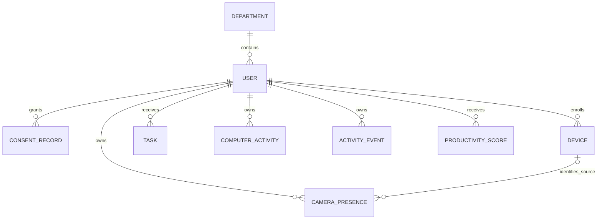

# WorkTrack — Хөгжүүлэгчийн гарын авлага

Энгийн хэрэглээ: [README](../README.md). Админ: [admin.md](admin.md).

## Тохируулах

```bash
python3 -m venv .venv
source .venv/bin/activate
pip install -r backend/requirements.txt
npm ci
cp backend/.env.example backend/.env
```

`backend/.env` дахь `DJANGO_SECRET_KEY`-г өөрийн random утгаар солино.
Хэрэв файл өмнө нь байгаа бол хуулж дарж болохгүй.
Backend зөвхөн `backend/.env` дахь `DJANGO_*` болон баримтжуулсан бусад түлхүүрийг
уншина. Root `.env` нь шаардлагатай үед frontend-ийн `VITE_API_URL`-д зориулагдсан;
түүний `SECRET_KEY`, `DEBUG` нь Django-г тохируулахгүй. `.env` файлууд Git-д орохгүй.

```bash
python manage.py migrate
python manage.py createsuperuser
python manage.py runserver
```

Хоёр дахь terminal:

```bash
npm run dev
```

http://localhost:5173 дээр superuser-аар нэвтэрнэ. Vite `/api/` хүсэлтийг
http://127.0.0.1:8000 руу дамжуулна. Production build-д ижил origin reverse proxy
эсвэл build хийхээс өмнө `VITE_API_URL` болон backend CORS тохируулна.

## Computer agent (үндсэн)

```bash
pip install -r activity_agent/requirements.txt
cp agent/config.example.json agent/config.json
python agent/main.py --login
python agent/main.py --grant-consent 2026-11
python agent/main.py
```

Тохиргооны API URL нь `http://127.0.0.1:8000`. Employee account-аар login хийнэ.
Agent нь device enroll, JWT refresh, offline queue ашиглана. OS-specific setup-ийг
`agent/` доторх script-үүдээс харна. Давхар хугацаа бүртгэхээс сэргийлж нэг компьютер
дээр хоёр computer agent зэрэг ажиллуулахгүй.

### Үндсэн agent-ийн хугацааны нарийвчлал

`agent/config.json` дахь `poll_interval_seconds` нь идэвхтэй апп шалгах давтамж
(default **1 секунд**), `interval_seconds` нь сервер рүү хуримтлагдсан segment-үүдийг
илгээх давтамж (default **30 секунд**) юм. Хуучин config-д шинэ түлхүүр байхгүй байсан
ч 1 секундийн default автоматаар хэрэглэгдэнэ.

VS Code → Safari → VS Code гэж 30 секунд дотор солигдсон ч segment бүр тусдаа
хадгалагдана. Апп хэвээр байсан ч 30 секунд тутам segment-ийг тасалж илгээнэ.
Upload нь тусдаа thread дээр ажилладаг тул сүлжээ удаашрахад sampler-ийг хүлээлгэхгүй.
Segment хаагдах бүрд offline queue-д хадгална; retry нь дараагийн upload мөчлөгт хийгдэнэ.
Ctrl+C үед сүүлийн ажигласан цаг хүртэлх segment-ийг хадгалж, queue илгээхэд
хамгийн ихдээ 5 секунд хүлээнэ. Үлдсэн өгөгдөл дараагийн асаалтанд дахин илгээгдэнэ.

Энэ нь polling тул 1 секундээс богино апп шилжилт алдагдаж болно; OS lookup удах үед
бодит sample хоорондын хугацаа уртсаж болно. Апп таних алдаа гарвал танигдаагүй
завсрыг өмнөх аппад таамгаар нэмэхгүй. Pause үед шинэ хугацаа цуглуулахгүй.
Энэ өөрчлөлт alternative `activity_agent/`-ийн collector-т хамаарахгүй.

### Өдөр солигдох, sleep/resume

Үндсэн agent-ийн interval-ийг `Asia/Ulaanbaatar`-ын 00:00 заагаар хуваана.
Жишээ нь 23:59:50–00:00:10 хооронд Code ашиглавал хоёр өдөрт тус бүр 10 секунд
хадгална. OS timezone өөр байсан ч тайлангийн өдөр Улаанбаатараар тооцогдоно.
API-ийн 3600 секундийн хязгаарыг давах урт segment мөн жижиглэгдэнэ.

`max_sample_gap_seconds` нь default **10 секунд**. Хоёр observation хооронд
үүнээс урт завсар гарвал үндсэн agent өмнөх segment-ийг сүүлийн баталгаатай
observation дээр дуусгаж, сэрсний дараа шинээр эхлүүлнэ. Sleep болон удаан гацсан
завсрыг ашигласан хугацаанд тооцохгүй. Энэ нь OS sleep event биш, sampling gap-д
суурилсан хамгаалалт учраас 10 секундээс богино sleep-ийг ялгахгүй.

Wall clock болон monotonic clock зөрөх, цаг ухрах үед мөн interval тасална.
Цаг ухарвал өмнө хадгалсан дууссан цагт хүрэх хүртэл шинэ хугацаа бүртгэхгүй,
ингэснээр давхардсан мөр үүсгэхгүй. Компьютерийн цаг серверээс ихээр түрүүлсэн бол
серверийн future-time validation хүсэлтийг буцааж болох тул OS цагийг зөв тохируулна.

Single-person camera uploader ч segment-ээ өдөр болон 3600 секундээр хуваана.
Camera timestamp нь дууссан цаг тул яг 00:00-д дууссан хэсэг өмнөх өдөрт тоологдоно.
Backend camera тайланд өмнө нь хадгалсан өдөр дамнасан мөрийн хугацааг мөн хоёр
өдөрт хувааж харуулна; database-ийн хуучин мөрийг өөрчлөхгүй. Camera tracker мөн `max_camera_gap_seconds` (default 10) хамгаалалттай. Single болон
multi-person горимд урт observation gap-ийг тооцохгүй, өмнөх хугацааг сүүлийн frame
ажигласан timestamp-тайгаар хадгална.

## Activity agent (өөр хувилбар)

```bash
pip install -r activity_agent/requirements.txt
python agent/main.py --login
python agent/main.py --grant-consent 2026-11
```

`activity_agent/config.json` дахь `employee_id`-г login хийсэн username болгон солино.
`token_file` нь үндсэн agent-ийн JWT файл; `dev-token` ашиглахгүй.

```bash
python activity_agent/agent.py run
```

`POST /api/v1/activity` compatibility endpoint нь batch-ийг ижил Django database-д
хадгалж, retry хийхэд ижил мөрийг дахин үүсгэхгүй. Aggregate app хугацаанд дарааллын
мэдээлэл байдаггүй тул хадгалсан цагийн offset нь бодит foreground дараалал биш.
Энэ contract-ийн аппуудыг төв monitoring тохиргооны productive apps жагсаалтаар
`WORK`, browser нэрээр `BROWSER`, харилцааны аппын нэрээр `COMMUNICATION`, бусдыг
`OTHER` гэж ангилна. Idle хугацааг `Idle/OTHER`, апп нь тодорхойгүй active хугацааг
`Unattributed activity/OTHER` segment болгон хадгалж, W-ийн нийт хугацаанд оруулна.
Keyboard/mouse event тоонуудыг database-д хадгалахгүй. Mock server нь зөвхөн тусдаа
тестийн хэрэгсэл; үндсэн системд асаах шаардлагагүй.

## Camera

macOS дээр `NSCameraUsageDescription` дутуу Python process-оос capture хийхэд TCC
процессыг SIGABRT-аар хааж болно. Camera CLI болон вебийн товч нь өөрийн signed
**WorkTrack Camera** bundle дотор Python/OpenCV-г ажиллуулна. System Python-ийн
Info.plist-ийг өөрчлөхгүй. Camera болон төслийн хавтсын тайлбар bundle-д байна;
камерын OS зөвшөөрлийг capture-ээс өмнө шалгана. Зөвшөөрөөгүй бол crash хийхийн
оронд Settings → Privacy & Security → Camera → WorkTrack Camera гэдгийг заана.

Bundle нь эхний ашиглалтад Command Line Tools-оор build хийгдэж, macOS-ийн private
temporary cache-д хадгалагдана. Ингэснээр iCloud Desktop-ийн Finder metadata кодын
signature-д саад болохгүй. Cache арилсан, Python эсвэл host эх код өөрчлөгдвөл
дахин бүтээнэ. Зураг/видео хадгалахгүй; зөвхөн одоогийн presence metadata хэвээр.
Startup-ийг цуцлахад session permit эхэлж хүчингүй болно. Хоцорч ассан native host
болон OS permission хүлээж буй worker цуцлагдсан session-оор capture эхлүүлэхгүй.

```bash
pip install -r requirements.txt
python main.py
```

`config.yaml`-ийн `api_sync.enabled: true` нь camera state-ийг agent-ийн account,
device, token ашиглан илгээнэ. Default `camera_mode: presence` үед зөвхөн timestamp,
`present` boolean, confidence хадгалж `/api/camera-presence/ingest/` ашиглана.
Camera permission болон тухайн session-д зөвшөөрөл шаардлагатай. API нь active
monitoring consent-ийг үргэлж шалгана. Presence нь productivity score-д шууд орохгүй.
Өмнөх state experiment-ийг `python main.py --mode activity` гэж тусад нь асаана;
тэр нь `/api/activity-events/ingest/` ашиглана. Multi-person identity integration
хийгдээгүй. Аль ч горимд raw зураг API руу илгээхгүй.

API sync асаалттай үед presence, legacy activity болон multi-person бүх горим server consent lease,
local pause-ийг шалгаж, татгалзсан/хугацаа дууссан үед camera-г суллаж, CSV бичихээ
зогсооно. `--seconds 20` хугацааны хязгаар бүх горимд үйлчилнэ. Multi-person-ийн
server identity/sync байхгүй тул зөвхөн consent-оор хамгаалсан local log үүсгэнэ.
Legacy CSV ч хэмжээ/хоногоор эргэлдэнэ. Presence, single-person, multi-person-ийн
CSV бүтэц өөр тул `config.yaml` дахь `log_file`-ийг тусдаа нэрээр сонгоно;
өөр бүтэцтэй хуучин файл дээр мөр нэмж хольж бичихгүй.

## Camera, AI, QA, documentation

Энэ хэсэг нь 5 дахь гишүүний 7 өдрийн ажлын хэрэгжүүлэлт, хэмжилт болон demo-ийн
лавлагаа. Ажлын manifest: [qa/board.json](../qa/board.json), consent checklist:
[qa/consent_checklist.csv](../qa/consent_checklist.csv), bug/validation gap:
[qa/bugs.json](../qa/bugs.json). Нэг README-г үндсэн баримт хэвээр ашиглана.

| Өдөр | Бэлэн үр дүн | Баталгаажуулалт |
|---|---|---|
| 1 | Privacy scope, task manifest, GitHub issue/PR template | `.github/ISSUE_TEMPLATE/qa-task.yml`, `.github/pull_request_template.md` |
| 2 | ERD/API review, 5 fictional test user-ийн consent lifecycle | `backend/activity/test_presence.py` |
| 3 | Agent expected/actual event report: switch, stable, pause, sleep, idle | `qa/fixtures/agent_cases.json`, `qa/agent_correctness.py` |
| 4 | OpenCV/YOLO person present/absent, configurable confidence, metadata log | `src/presence.py`, `src/detector.py`, `tests/test_presence.py` |
| 5 | Random Forest Low/Medium/High experiment, feature/label contract, grouped holdout | `ai/experiment.py`, `qa/fixtures/ai_demo.csv` |
| 6 | Camera Precision/Recall/F1, AI Accuracy/F1, final QA runner, CI artifacts | `evaluate_camera.py`, `verify_camera_ai.py`, `.github/workflows/qa.yml` |
| 7 | Demo script, test evidence, rehearsal checklist | `qa/evidence/final-qa.json`, `qa/rehearsal.json`; хүнтэй rehearsal pending |

### Privacy ба test data

Default camera mode нь frame-ийг RAM-д боловсруулна. YOLO-д `save=False`,
`save_txt=False`, `save_crop=False`, `show=False` өгдөг; OpenCV зөвхөн preview
харуулна. Frame/video, нүүрний embedding, bounding box, нэр, нас болон хүн таних
мэдээлэл хадгалахгүй. `confidence` нь threshold-ийг давсан person detection-уудын
хамгийн их confidence; person илрээгүй бол 0. Энэ нь хүн байхгүй гэсэн probability
эсвэл ажиллаж байгаа гэсэн үнэлгээ биш. Default threshold 0.45; model/threshold-ийг
хэмжилтийн тайланд хамт тэмдэглэж, test set дээр тааруулж өндөр metric гаргахгүй.

Local CSV: `data/presence.csv`, баганууд `timestamp,present,confidence`.
`presence_log_max_bytes` default 5 MiB; хэмжээ хүрэхэд эсвэл Улаанбаатарын өдөр
солигдоход шинэ CSV нээнэ. `presence_log_backups: 3` нь хамгийн ихдээ 3 дугаарласан
backup, `presence_log_retention_days: 7` нь хуучин generated CSV-г цэвэрлэнэ.
Хуучин файл аль хэдийн хязгаараас том байвал хамгийн сүүлийн бүтэн мөрүүдийг
үлдээж atomic rewrite хийнэ. Өөр нэртэй manual archive-д хүрэхгүй.
Offline queue: `data/.pending_presence_events.json`; upload нь тусдаа thread,
bounded queue, retry/quarantine болон shared token lock ашиглана. API дээр employee
нь JWT-ээс, device нь тухайн хэрэглэгчийн enroll-оос тогтоно. Зураг/video зэрэг
илүү field, бусдын device, ирээдүйн timestamp, NaN/Infinity confidence-ийг хүлээн
авахгүй. Ижил timestamp-тай ижил sample replay 200; өөр утгатай replay 400.

Session camera consent-ийг `python main.py` асууна. Launcher-ийн camera `y` сонголт
нь тухайн camera session-ийн зөвшөөрөл болно. `python agent/main.py --pause` эсвэл
`--revoke-consent` нь local camera sampling-ийг pause хийнэ. API sync асаалттай үед
camera нээхээс өмнө server consent-ийг background шалгалтаар баталгаажуулна.
Шалгалт 1 секунд тутам; баталгаа 3 секундээс хуучирвал эсвэл шалгалт алдахад
camera pause болж, preview харлаж, local CSV-д шинэ sample бичихгүй. Серверийн
401/403 upload denial мөн зөвшөөрлийг шууд invalidate хийнэ. Inference дундуур
зөвшөөрөл өөрчлөгдвөл тухайн sample-ийг хаяж, дараагийн loop дээр camera-г суллана.
Pause болон consent хүлээх үед ч `q` ажиллана. Consent дахин баталгаажиж, local
pause тайлагдвал collection үргэлжилнэ. API sync унтраасан standalone demo нь
тухайн session-ийн explicit local consent ашиглана.
Зөвшөөрлийг бодит хүний өмнөөс автоматаар олгохгүй. 5 checklist account нь зөвхөн
Django-ийн түр test database-д үүснэ; бодит database-д user/consent нэмэхгүй.
Real label цуглуулахын өмнө оролцогч сайн дураар зөвшөөрч, хүрээг тайлбарлуулсан байна.

Presence metadata нь `cleanup_activity --days 90` preview болон `--apply` retention-д
хамрагдана. Local presence CSV дээр дээрх rotation/retention үйлчилнэ; manually
цуглуулсан label файлуудыг хэрэгцээ дуусмагц оператор устгана. Эдгээрийг Git-д
оруулахгүй. QA artifact-д scalar aggregate, fictional fixture л оруулна.

### ERD / API review



Review: user ownership FK; device устгавал presence device нь NULL, user устгавал
өөрийн presence cascade; `(employee,timestamp)` unique. API list нь admin бүх,
manager өөрийн хэлтэс, employee зөвхөн өөрийн metadata-г харна. Presence list нь
read-only, ingest нь зөвхөн өөрийн JWT identity-д бичнэ. Confidence нь [0,1],
present нь JSON boolean. Backend migration: `0004_camerapresence`.

```json
{"timestamp":"2026-11-06T10:00:00+08:00","present":true,"confidence":0.83}
```

Үүнийг JWT header-тэй `POST /api/camera-presence/ingest/` рүү илгээнэ. Five-user
тест нь no-consent 403 → grant → 201 → replay 200 → self-only list → revoke → 403
дарааллыг тус бүрд шалгана. Foreign device/ownership, invalid metadata, manager
scope болон бодит HTTP upload + JWT refresh мөн тесттэй.

### Random Forest experiment

Dashboard API нь сонгосон ажилтан/Улаанбаатарын өдрийн `presence` summary-г буцаана:
нийт, present/absent sample count, present хувь, сүүлийн timestamp/boolean/confidence.
Frontend-ийн Camera activity хэсэг эдгээрийг харуулна. Sample count-ийг ажилласан
минут гэж хөрвүүлэхгүй; official score-д presence boolean-ийг шууд ашиглахгүй.

```bash
pip install -r requirements-ai.txt
python -m ai.experiment
python -m ai.experiment --csv qa/fixtures/ai_demo.csv --data-kind synthetic
```

Бүх feature нь нэг тогтсон research window-ийн [0,1] aggregate ratio:

| Feature | Тодорхойлолт |
|---|---|
| `active_ratio` | non-idle секунд / ажиглагдсан computer секунд |
| `work_app_ratio` | тохируулсан WORK app секунд / ажиглагдсан computer секунд |
| `presence_ratio` | present sample / ажиглагдсан camera sample |
| `task_completion_ratio` | тухайн window-д оноосон task-аас дууссан хувь |

Zero observation/zero assigned task үед 0 гэж таахгүй: бодит dataset-д missing
window-ийг хасаж эсвэл тусдаа missing-data protocol тодорхойлно. Feature бүр ижил
window-д хамаарах ёстой; window дууссаны дараах task outcome-ийг input-д оруулахгүй.
Жинхэнэ label нь тусдаа human annotation rubric-аар Low/Medium/High байна;
ажилтны чанарыг camera-аар дүгнэхгүй. Real annotator-ууд feature/таамаглалыг харж
label хуулж тавихгүй; санал зөрөлдөх, missing label-ийг тусад нь бүртгэнэ.

Одоогийн 450 window, 5 fictional participant-ийн dataset **synthetic**. Label нь
noisy latent simulation-оос үүссэн; бодит бүтээмжийн ground truth биш. CSV нь
`participant_id,sample_id,data_kind,active_ratio,work_app_ratio,presence_ratio,task_completion_ratio,label`
гэсэн яг энэ schema-тай. Seed 42, 200 tree, max depth 6, min leaf 3.
Participant-аар `GroupShuffleSplit`: train 3 participant / 270 sample, test 2 / 180;
оролцогчийн давхцал 0. Test set-ийг hyperparameter сонгоход ашиглаагүй.
Одоогийн нэг split нь тогтвортой generalization/шалтгаант үр нөлөөг батлахгүй.
Report-д library version, seed, dataset checksum, baseline, class support,
confusion matrix, feature importance орно. Official scoring formula-д model-ийг
холбоогүй. Data хангалтгүй тул энэ нь **experimental result** хэвээр.

### Camera evaluation ба metric table

Бодит label цуглуулахдаа оролцогчийн зөвшөөрөлтэйгээр:

```bash
python -m qa.collect_camera_labels --consent
python evaluate_camera.py .runtime/qa/camera-labeled.csv --mode presence --data-kind real --output .runtime/qa/camera-metrics.json
```

Operator `p` (person present), `a` (absent) expected label-ийг **inference-ээс өмнө**
өгнө; prediction-оос expected label үүсгэхгүй. Утга хадгалахдаа timestamp, random
sample ID, expected/predicted boolean, confidence, data kind л хадгална. Янз бүрийн
гэрэл, зай, хагас халхлалт, present/absent-ийн coverage хэрэгтэй. Зорилтот validation
нь тус бүр дор хаяж 50 бие даасан present/absent observation, нэг frame-ийг олон
удаа тоолж metric өсгөхгүй. 100 sample нь хүртэл production certification биш.

| Хэмжилт | Өгөгдөл / хамрах хүрээ | Одоогийн үр дүн |
|---|---|---|
| Camera live smoke | Зөвшөөрсөн 20 metadata sample; human label байхгүй | 19 present, 1 absent prediction; accuracy тооцоогүй |
| Camera evaluator fixture | 8 **synthetic** мөр | Precision 0.750, Recall 0.750, F1 0.750; бодит camera metric биш |
| Camera real Precision/Recall/F1 | Independent human labels | **Pending** |
| Random Forest Accuracy | Synthetic; 180 held-out sample | 0.7611 |
| Random Forest macro F1 | Synthetic; Low/Medium/High | 0.7624 |
| Majority baseline Accuracy | Ижил synthetic holdout | 0.3333 |

Precision = TP/(TP+FP), Recall = TP/(TP+FN), F1 = 2TP/(2TP+FP+FN).
Denominator байхгүй metric нь null; support/coverage болон confusion matrix-ийг
хамт харна. Synthetic fixture-ийг real гэж дамжуулбал evaluator алдаа өгнө.
Хуучин 4-state evaluation `python evaluate_camera.py states.csv` хэвээр ажиллана.

### Final QA ба PR evidence

```bash
python verify_camera_ai.py
```

Python camera/AI tests → computer agent → alternative agent → Django integration
(5 consent test user орно) → frontend unit/lint/build → mocked browser tests →
түр database-тай бодит Django/browser demo-г ажиллуулна. Жинхэнэ webcam-ийг автоматаар
асаахгүй, бодит database-д fake user/record нэмэхгүй. Тест бүрийн command, exit code,
хугацаа, log, Git revision, dirty flag, source checksum, agent expected/actual events,
AI болон synthetic evaluator metric-ийг `.runtime/qa/final-qa.json`-д бичнэ.
Алдаа/тасалдсан run-ийг passed гэж бичихгүй. Full QA-д Chromium хэрэгтэй:
`npx playwright install chromium`. `--skip-browser` нь бодит browser/Django run-ийг
explicit skipped болгон тэмдэглэнэ; full-system QA-тай адил гэж үзэхгүй.

Сүүлийн reviewed snapshot: [qa/evidence/final-qa.json](../qa/evidence/final-qa.json).
Real hardware smoke log-ийн aggregate-ийг report-д нэмэх бол
`--camera-log .runtime/qa/camera-live.csv` ашиглана; raw frame хэрэггүй.
CI workflow нь PR/main run бүрийн evidence/log-ийг 14 хоногийн artifact болгоно.
Remote CI run нь push хийгдсэний дараа л үүснэ; local test-ийг remote CI гэж нэрлэхгүй.

GitHub issue board: [7 өдрийн board #9](https://github.com/tugsbilegb49-coder/team-project1/issues/9),
[milestone](https://github.com/tugsbilegb49-coder/team-project1/milestone/1), task issue #2–#8.
Нэвтрэх эрхийг нэмэгдүүлэхгүйгээр одоогийн git login-оор issue/milestone board үүсгэсэн.
Дахин sync хийх болон тусдаа GitHub Projects хувилбар:

```bash
python qa/publish_board.py              # Reviewable dry-run; GitHub холболт шаардахгүй
python qa/publish_board.py --apply --issues-only  # Одоогийн git login; issue/milestone board
python qa/publish_board.py --apply      # Тусдаа GitHub Projects; gh auth + project эрхтэй үед
python qa/publish_board.py --apply --project 3   # Өмнөх project-оо дахин ашиглана
```

Publisher нь manifest-ийн 7 issue-г үүсгэж project-д холбоно; acceptance checkbox-ийг
шалгаагүй байхад Done гэж хаахгүй. Дахин ажиллуулахдаа өмнөх project number-ийг
өгнө. Existing issue-г title-аар дахин ашиглана. Багийн **PR бүрд** linked issue,
tested revision, command/result, CI artifact URL шаардлагатай. PR template-ийн
evidence-г linked issue/project item дээр мөн шинэчилнэ. GitHub холболтгүй үед
manifest нь local бэлтгэл; remote board үүссэн гэж үзэхгүй.

### 7 дахь өдрийн demo / rehearsal

1. `Start WorkTrack.command` нээж, admin login, test ажилтан/task болон dashboard
   урсгалыг харуулна. Бодит хүний нэр/нууц мэдээлэл demo-д оруулахгүй.
2. Privacy scope-ийг тайлбарлаж, сайн дурын demo account-ийн monitoring consent,
   camera session permission-ийг өгнө.
3. `python main.py --consent --seconds 20` — хүн харагдах, frame-ээс гарах, буцаж
   орохыг харуулна. `data/presence.csv`-ийн зөвхөн 3 багана, зураг/video байхгүйг шалгана.
4. Pause/resume, consent revoke хийж sampling болон API rejection-ийг харуулна.
   Camera-г Ctrl+C/q-ээр бүрэн зогсооно.
5. `python -m ai.experiment` ажиллуулж Low/Medium/High, Accuracy/F1, baseline,
   grouped holdout, synthetic хязгаарлалтыг тайлбарлана.
6. `python verify_camera_ai.py` болон report-ийг харуулж agent expected/actual,
   consent lifecycle, browser/API integration болон open validation gap-уудыг хэлнэ.
7. Launcher-ийг Ctrl+C-ээр зогсоож camera indicator унтарсныг шалгана.

Жинхэнэ rehearsal хийсэн хүн [qa/rehearsal.json](../qa/rehearsal.json)-д presenter,
performed_at, алхам бүрийн actual result/evidence-г бичнэ. Автомат тест нь хүний
live presentation rehearsal-ийг хийсэн гэж батлахгүй.

Implementation лавлагаа: [Ultralytics predict](https://docs.ultralytics.com/modes/predict/),
[RandomForestClassifier](https://scikit-learn.org/stable/modules/generated/sklearn.ensemble.RandomForestClassifier.html),
[GroupShuffleSplit](https://scikit-learn.org/stable/modules/generated/sklearn.model_selection.GroupShuffleSplit.html).

## Шалгах

```bash
python manage.py check
python manage.py makemigrations --check --dry-run
python manage.py test users workforce activity scoring
python -m unittest discover -s agent -p 'test*.py'
python -m unittest discover -s activity_agent/tests
npm run test
npm run lint
npm run build
```

Launcher-ийг бодитоор асааж/зогсоох шалгалт (`python verify_launcher.py`) нь түр database
ашиглана. Холбогдсон төхөөрөмжтэй хавтсанд ажиллахгүй тул цэвэр checkout эсвэл CI-д ажиллуулна.

Integration тест нь JWT login → task → device/consent → computer/camera ingest →
score → dashboard урсгал, batch replay, бусдын account-аар бичихийг хориглох,
invalid batch-ийн atomicity-г шалгана. Бодит camera capture болон PostgreSQL-г
эдгээр SQLite тестүүд баталгаажуулахгүй.

## API лавлагаа

Business API бүр JWT authentication шаарддаг. Login-оос авсан access token-ийг
`Authorization: Bearer ACCESS_TOKEN` header-т явуулна. Access token 30 минут,
refresh token 1 өдөр хүчинтэй. Agent-ууд refresh token ашиглан access-аа шинэчилнэ.

| Endpoint | Method | Зориулалт |
| --- | --- | --- |
| `/api/auth/login/` | POST | Username, password-аар access/refresh авах |
| `/api/auth/refresh/` | POST | Refresh token-оор access шинэчлэх |
| `/api/me/today/` | GET | Зөвхөн өөрийн өнөөдрийн хугацаа, апп, task |
| `/api/me/password/` | POST | current_password/new_password/confirm_password; session-уудыг цуцална |
| `/api/desktop/link/` | POST | Өөрийн device + explicit consent; тусдаа agent JWT; no-store |
| `/api/auth/logout/` | POST | Өөрийн refresh token-ийг хүчингүй болгох; access authentication шаардлагатай |
| `/api/users/`, `/api/users/{id}/` | GET, POST / GET, PUT, PATCH, DELETE | User удирдах; өөрчлөх эрх зөвхөн admin |
| `/api/users/me/` | GET | Одоогийн хэрэглэгч |
| `/api/departments/`, `/api/departments/{id}/` | GET, POST / GET, PUT, PATCH, DELETE | Хэлтэс; өөрчлөх эрх зөвхөн admin |
| `/api/tasks/`, `/api/tasks/{id}/` | GET, POST / GET, PUT, PATCH, DELETE | Task; өөрчлөх эрх admin/manager |
| `/api/tasks/{id}/transfer-recipients/` | GET | Шилжүүлж болох гишүүдийн id, нэр; хэлтсийн эрхээр хязгаарлана |
| `/api/tasks/{id}/transfer-request/` | POST | `recipient`, `note`; нэг хүлээгдэж буй хүсэлт, нийт хоёр зөвшөөрсөн шилжүүлэг |
| `/api/tasks/{id}/transfer-respond/` | POST | `request_id`, `decision`: accept/decline/cancel; accept/decline зөвхөн хүлээн авагч |
| `/api/tasks/{id}/progress/` | POST | `percent`, `expected_percent`; одоогийн хариуцагчийн хувь, нийт ≤100 |
| `/api/tasks/{id}/work-start/` | POST | Хоосон JSON; нэг ажилтан нэг идэвхтэй таймер |
| `/api/tasks/{id}/work-stop/` | POST | `session_id`; зөвхөн өөрийн таймерыг зогсооно |
| `/api/tasks/work-session/` | GET, POST | Өөрийн session; POST `session_id` холболтыг батална, 90 секундийн хязгаартай |
| `/api/devices/enroll/` | POST | Өөрийн workstation бүртгүүлэх |
| `/api/devices/` | GET | Харах эрхтэй device-ууд |
| `/api/agent-status/` | GET | Эрхийн хүрээний төхөөрөмж, agent heartbeat/queue төлөв |
| `/api/agent-status/heartbeat/` | POST | Өөрийн enabled device-ийн operational metadata |
| `/api/monitoring-settings/` | GET, PATCH | Бүгд уншина; зөвхөн admin `expected_version`-той засна |
| `/api/notifications/` | GET | Task, agent, upload-ийн веб мэдэгдэл |
| `/api/audit/` | GET | Эрхийн хүрээний өөрчлөлтийн түүх; pagination |
| `/api/reports/export/?start=2026-11-01&end=2026-11-05&employee_id=all&file_type=xlsx` | GET | CSV эсвэл Excel өдрийн тайлан татах |
| `/api/reports/monthly/?month=2026-11` | GET | Эрхийн хүрээн дэх ажилтны сарын програм/апп/idle/даалгаврын цаг, дууссан ажил, шилжүүлэг |
| `/api/launcher-usage/` | POST | Өөрийн enabled device + active consent; `device_id`, ≤100 `intervals` (`event_id`, `started_at`, `ended_at`), давхардсан retry аюулгүй |
| `/api/consents/grant/` | POST | Өөрийн monitoring consent олгох |
| `/api/consents/revoke/` | POST | Өөрийн consent цуцлах |
| `/api/consents/status/` | GET | Өөрийн consent төлөв |
| `/api/computer-activity/ingest/` | POST | Үндсэн agent-ийн application segment |
| `/api/computer-activity/` | GET | Computer activity түүх |
| `/api/website-activity/ingest/` | POST | Идэвхтэй consent-тэй extension-ийн домэйн ба хугацаа; URL зам, хуудасны агуулга авахгүй |
| `/api/website-activity/` | GET | Эрхийн хүрээн дэх вэбсайт ашиглалтын түүх |
| `/api/activity-events/ingest/` | POST | Өөрийн camera state segment |
| `/api/camera-presence/ingest/` | POST | Зөвшөөрөлтэй өөрийн presence boolean/confidence |
| `/api/camera-presence/` | GET | Эрхийн хүрээн дэх presence metadata; pagination ашиглана |
| `/api/activity-events/` | GET | Camera activity түүх |
| `/api/v1/activity` | POST | Өөр agent-ийн v1.0 batch; төгсгөлийн `/` байхгүй |
| `/api/scores/calculate/` | POST | Employee/date оноо тооцох буюу шинэчлэх |
| `/api/scores/dashboard/?employee_id=2&date=2026-11-05` | GET | Өдрийн score, application, camera summary |
| `/api/scores/` | GET | Харах эрхтэй онооны түүх |

List хариу нь `count`, `next`, `previous`, `results` бүтэцтэй; нэг хуудсанд 50 мөр.
`employee`, `employee_id`, `device_id` утгуудыг бодит API хариунаас авна.

Login хүсэлтийн JSON:

```json
{"username":"employee1","password":"YOUR_PASSWORD"}
```

Task үүсгэх JSON (admin/manager):

```json
{"employee":2,"title":"API integration","description":"Agent холбох","due_date":"2026-11-05","status":"TODO"}
```

Task status нь `TODO`, `IN_PROGRESS`, `DONE`. `DONE` болоход сервер `completed_at`
онооно; дахин нээхэд цэвэрлэнэ. `quality_score` нь 0–100 эсвэл null.

Computer segment-ийн JSON (тухайн employee-ийн token):

```json
{"started_at":"2026-11-05T10:00:00+08:00","duration_seconds":30,"application":"Code","category":"WORK"}
```

Category: `WORK`, `COMMUNICATION`, `BROWSER`, `OTHER`. Camera segment:

```json
{"timestamp":"2026-11-05T10:00:00+08:00","duration_seconds":30,"state":"WORKING"}
```

Camera state: `WORKING`, `PHONE`, `IDLE`, `AWAY`. Хоёр ingest endpoint-д enrollment
хариуны `device_id`-г нэмэх боломжтой; device нь нэвтэрсэн хэрэглэгчийнх байна.
`REQUIRE_MONITORING_CONSENT=true` үед өмнө нь consent grant хийсэн байх ёстой:

```json
{"policy_version":"2026-11"}
```

Оноо тооцох JSON:

```json
{"employee_id":2,"date":"2026-11-05"}
```

Admin бүх ажилтанд, manager өөрийн хэлтэст, employee өөртөө оноо тооцож болно.
Ирээдүйн өдрийн оноо тооцохгүй. Өгөгдөл өөрчлөгдвөл дахин тооцно.

## Frontend-ийн regression шалгалт

```bash
npm run test                         # API/session unit tests
npm run lint
npm run build
npx playwright install chromium      # Browser test runtime, нэг удаа
npm run test:e2e                      # Mock API-тай бодит browser regression
python verify_frontend.py            # Шинэ түр DB + бодит Django + browser smoke
```

Browser regression нь хадгалалтын үеийн task draft, manager-ийн хэлтэс,
идэвхгүй assignee, quality validation/save, report selection болон late response,
server logout, offline startup/retry, expired session, 320px chart overflow-ийг
шалгана. Playwright нь тусдаа Vite порт ашиглаж, үндсэн backend руу test өгөгдөл
бичихгүй. `verify_frontend.py` нь түр SQLite DB/server үүсгэж login → department →
manager → task → quality → deactivate → logout/refresh revocation урсгалыг
бодитоор ажиллуулаад бүх түр process/file-аа цэвэрлэнэ.

Default browser suite-д live smoke case алгасагдана; түүнийг `verify_frontend.py`-аар
ажиллуулна. Test artifact нь `.runtime/frontend-e2e/` дотор, Git-д орохгүй.
Өөр ажилтан/өдөр сонгоход хуучин тайлан шууд нуугдаж, шинэ хүсэлтийн хариуг л харуулна.
Хадгалалтын үед task form нуухгүй, талбаруудыг disable хийж draft-ийг хадгална.

## Бодит орчны шалгалт

2026-11-06-нд энэ Mac дээр хийсэн шалгалтууд:

| Шалгалт | Үр дүн |
| --- | --- |
| macOS foreground app | Safari → Code гэж бодитоор шилжүүлэхэд хоёул зөв танигдсан |
| Idle timer | OS-оос idle секунд уншигдсан |
| Camera capture | Webcam нээгдэж 1920×1080 frame ирсэн |
| Camera → YOLO → state | Бодит нэг frame боловсруулж хүчинтэй state буцаасан; зураг хадгалаагүй/upload хийгээгүй |
| Primary agent offline → recovery | Бодит TCP connection-refused үед queue хадгалж, Django HTTP сервер сэргэхэд илгээсэн; replay давхар хугацаа үүсгээгүй |
| Tracker/association/gaze | 17 unit тест амжилттай; энэ нь бодит detection accuracy-ийн үнэлгээ биш |
| Sleep/resume | Хэрэглэгч Mac-аа унтуулаад сэрээсэн; 10.17 секундийн observation gap илэрч app time-д ороогүй |
| PostgreSQL 17.11 | Migration, shared cache, 2-worker Gunicorn болон 70 backend test case шалгасан; opt-in soak 1 case тусдаа ажилласан |
| PostgreSQL concurrency | Давхардсан хоёр хүсэлтээс нэг нь 201, нөгөө нь 400; ижил replay нь 201/200, нэг мөр хадгалсан |
| PostgreSQL backup/restore | `pg_dump` → өөрчлөлт оруулах → `pg_restore` → өөрчлөлт буцсан; safety dump-ийг өөр database-д мөн сэргээсэн |

Offline/recovery туршилт нь **локал endpoint хүрэхгүй болох** нөхцөл үүсгэсэн;
Mac-ийн Wi-Fi-г унтраагаагүй. Django-ийн түр test database ашигласан, үндсэн
хэрэглэгчийн database руу test event нэмээгүй. YOLO-ийн стандарт `yolov8n.pt` weight
локал татагдсан бөгөөд Git-д орохгүй.

Дахин шалгах integration тест:

```bash
python manage.py test workforce.tests.LiveUploaderTests.test_primary_agent_offline_queue_recovers_against_real_django
python -m pytest tests/test_activity_tracker.py tests/test_association.py tests/test_gaze.py -q
```

Sleep/resume-ийг өөрөө туршихдаа launcher-аа асааж, VS Code дээр хэдэн секунд
ажиллаад Apple → Sleep сонгон 20 секундээс удаан хүлээнэ. Сэрээсний дараа дахин
хэдэн секунд ажиллаад `.runtime/agent.log` дахь `Sleep/clock gap skipped` мөрийг
шалгана. Dashboard-ийн нийт app хугацаанд унтсан 20 секунд нэмэгдээгүй байх ёстой.
Туршилтын өмнөх/дараах хугацааг ялгаж үзнэ; нийт өмнөх бүртгэлийг нойртой андуурахгүй.

PostgreSQL-ийн тестэд тусдаа тестийн server/database болон test database үүсгэх
эрхтэй хэрэглэгч хэрэгтэй. `backend/.env`-ийн `POSTGRES_*`-ийг тухайн орчинд
тохируулж `python manage.py test users workforce activity scoring` ажиллуулна.
SQLite дээрх амжилт PostgreSQL row locking, migration, backup/restore-ийг дангаараа
батлахгүй. Энэ Mac дээр PostgreSQL 17 суулгаж, зөвхөн private Unix socket ашигласан
түр cluster дээр дээрх тестүүдийг хийсэн. Байнгын service асаагаагүй, үндсэн
SQLite database болон `backend/.env`-ийг PostgreSQL рүү өөрчлөөгүй.

Дахин тусгаарласан PostgreSQL шалгалт хийх:

```bash
python verify_postgresql.py
# PATH-д PostgreSQL tool байхгүй бол:
python verify_postgresql.py --pg-bin /opt/homebrew/opt/postgresql@17/bin
```

Энэ script нь түр cluster/database үүсгэж, migrations, нийт backend тест,
concurrent ingest, backup/restore шалгаад серверээ зогсоож cluster-ээ устгана.
Үндсэн database руу холбогдохгүй. macOS/Linux дээр локал PostgreSQL binary шаардана.
Товч үр дүн `.runtime/postgresql-verification.json` файлд үлдэнэ.

Бодит sleep хэмжилт хийх команд:

```bash
python verify_sleep.py
```

READY гарсны дараа Apple → Sleep сонгоод 20 секунд хүлээн сэрээнэ. Script нь
үндсэн agent-ийн бодит sampler-ийг ашиглах боловч HTTP uploader-ийг diagnostic
recorder-оор сольдог тул database руу бичихгүй. Сэрсний дараа 8 секунд ажиглаад
дуусна. Default дээд хугацаа 300 секунд. Завсар илрээгүй бол **inconclusive**,
илэрсэн завсрыг app time-д оруулаагүй бол **passed** гарна. Үр дүн
`.runtime/sleep-resume-test.json` файлд үлдэнэ.

## Activity хугацааны API шалгалт

Computer/camera ingest болон API-аар admin үүсгэх, засах хүсэлтэд дараах дүрэм үйлчилнэ:

- `duration_seconds` нь finite тоо, 0-ээс их, хамгийн ихдээ 3600 секунд байна.
- Computer event-ийн `started_at + duration_seconds` нь ирээдүйд байж болохгүй.
- Camera-ийн `timestamp` нь segment-ийн **дууссан цаг**; эхэлсэн цаг нь
  `timestamp - duration_seconds`. Дууссан цаг ирээдүйд байж болохгүй.
- Нэг ажилтны computer event-үүд төхөөрөмжөөс үл хамааран давхцахгүй.
  Camera нь тусдаа stream тул computer event-тэй зэрэг бүртгэгдэж болно.
- Camera uploader хугацааг 0.1 секундээр тоймлодог тул camera event хоорондын
  0.1 секунд хүртэлх rounding зөрүүг зөвшөөрнө. Computer stream-д энэ зөрүүг зөвшөөрөхгүй.
- Яг ижил event дахин ирвэл 200 буцааж, давхар мөр үүсгэхгүй. Залгаа interval-ууд зөвшөөрөгдөнө.
- Batch-ийн хугацаа ирээдүйд байж болохгүй. Нэг мөр давхцвал batch-ийн бүх шинэ мөр,
  тухайн хүсэлтээр үүсгэсэн device хамт rollback хийгдэнэ. Алдаа нь 400 байна.

Энэ шалгалт өмнө нь хадгалсан өгөгдлийг автоматаар цэвэрлэхгүй. Django admin сайт
болон CSV import нь API-аас тусдаа зам тул дээрх API шалгалтаар хамгаалагдахгүй.

## Activity agent-ийн contract ба найдвартай байдал

`activity_agent/` дотор `collector.py` нь хугацаа болон app-ийг цуглуулж,
`contract.py` batch үүсгэж шалгана. `sender.py` нь offline spool, retry, JWT refresh
хариуцна. `summary.py`, `mock_server.py` нь тусдаа туршилтын хэрэгсэл.

`POST /api/v1/activity` хүсэлт:

```json
{
  "schema_version":"1.0",
  "agent_version":"0.1.0",
  "employee_id":"employee1",
  "device_id":"dde59b7ef949f039",
  "period_start":"2026-11-05T02:00:00Z",
  "period_end":"2026-11-05T02:01:00Z",
  "active_seconds":42,
  "idle_seconds":18,
  "keyboard_events":120,
  "mouse_events":15,
  "apps":[{"name":"chrome.exe","seconds":30},{"name":"code.exe","seconds":12}]
}
```

`employee_id` нь нэвтэрсэн username эсвэл user ID-г string хэлбэрээр агуулна.
Цаг нь timezone-тай байна; agent UTC `Z` формат үүсгэдэг. Django өдрийн тайланг
`Asia/Ulaanbaatar` timezone-аар гаргана. Batch нь хамгийн ихдээ 3600 секунд,
500 app мөртэй. App секундийн нийлбэр active хугацаанаас хэтрэхгүй, rounding-ийн
2 секундийн зөрүү зөвшөөрнө. Validation бүхэлдээ амжилттай болсны дараа хадгална.

| Тохиргоо | Зориулалт |
| --- | --- |
| `api_url` | `http://127.0.0.1:8000/api/v1/activity` |
| `token_file` | `../agent/.agent_tokens.json`; зам нь config байрласан хавтаснаас |
| `employee_id` | Login хийсэн username |
| `batch_interval_seconds` | Batch илгээх давтамж; default 60 секунд |
| `idle_threshold_seconds` | Input байхгүй үед idle болох босго; default 60 секунд |
| `spool_file` | Илгээгдээгүй batch-ийн JSON Lines файл |
| `max_spool_batches` | Хадгалах batch-ийн дээд тоо; default 10000 |

Шинэ app мөр хадгалбал 201, ижил batch дахин ирж шинэ мөр үүсэхгүй бол 200.
Contract алдаа 400, JWT алдаа 401, identity/consent/device эрхийн алдаа 403.
Сүлжээний алдаа, 5xx, 408, 429 үед spool-д хадгалж дахин оролдоно. 401/403 үед
өгөгдлийг хадгалж login эсвэл consent засагдахыг хүлээнэ. Бусад 4xx алдаатай batch-ийг
log-д бичээд дахин илгээхгүй. Spool хязгаарт хүрвэл хамгийн хуучин batch-ууд хасагдана.

Agent restart хийсэн ч spool хадгалагдана. Laptop sleep-ийн 10 секундээс урт
завсрыг activity гэж тооцохгүй. Listener зогсвол main loop дахин эхлүүлнэ.
Нэг туршилтын batch илгээхдээ `python activity_agent/agent.py mock` ашиглана;
энэ нь тохируулсан бодит endpoint руу өгөгдөл бичдэгийг анхаарна.

\n